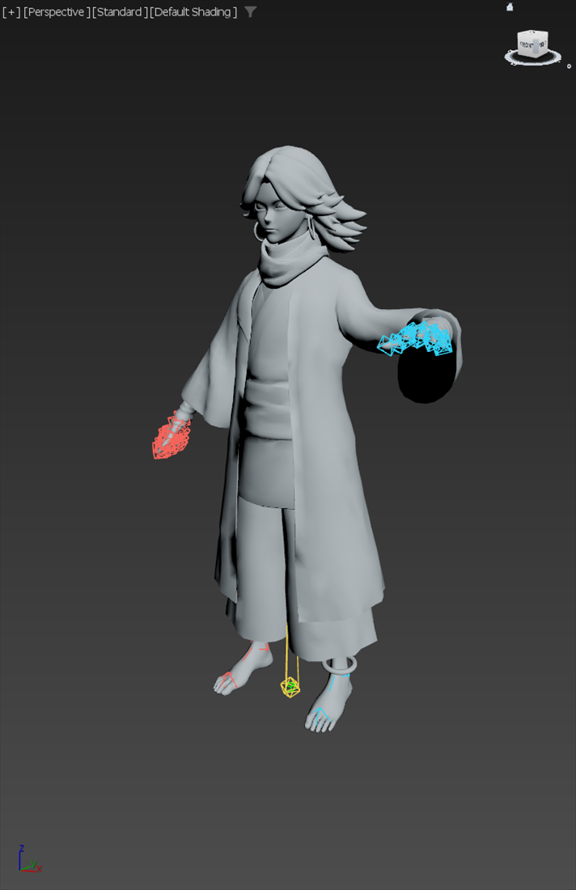
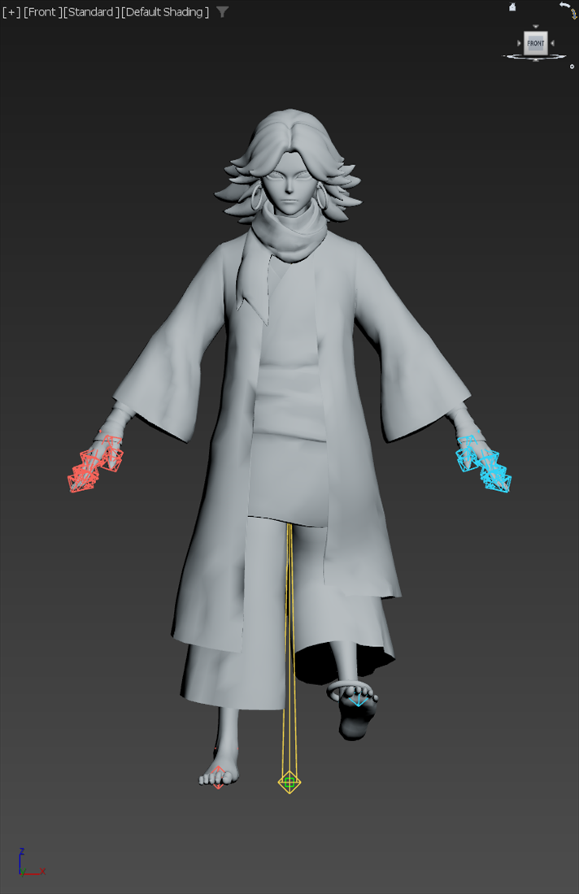

# Skinning with Geodesic Voxel in 3ds Max

English | [中文](README.zh.md)

## Summary

Use the built-in Skin Geodesic Voxel solver to produce initial weights for a character that already has a checked rest skeleton. The result is a starting point for deformation review and local weight editing. Complete weight coverage and normalization do not establish animation quality.

The measured case is Chistatic in 3ds Max 2026, with a Seven-compatible Dummy skeleton. Its bone count, endpoints, solver settings, timing, and residuals are case data; measure them again for another character.

## Table of Contents

- [1. Prepare the input](#preparation)
- [2. Define Skin segments for Dummy bones](#segments)
- [3. Calculate and compare weights](#solve)
- [4. Validate weights, poses, and saved files](#validation)
- [5. Refine the problem areas](#refinement)
- [6. Chistatic measurements](#evidence)
- [7. Continue with Biped and controls](#handoff)

<a id="preparation"></a>

## 1. Prepare the input

Confirm the target Max PID and full scene path before writing. Use the reference scene to inspect the skeleton; run the solver only on a saved target copy. Keep a `preSkin` snapshot, an external rest-matrix record, and the original mesh/material data.

| Check | Required record |
|---|---|
| Geometry | Mesh name, vertex/face counts, base vertices, face indices, UVs, material IDs, node transform and material assignment |
| Skeleton | Exact names and parents, world rest matrices, units, reference frame and animation/controller state |
| Skin | Existing modifier, influence names and existing weights; preserve an already weighted version before recalculation |

Add Skin to the target mesh and add only the intended deforming nodes. The Chistatic case keeps all 55 skeleton nodes but uses 54 Skin influences: `Root` remains the hierarchy root and has no direct vertex weights. This is a binding choice, not a universal requirement to remove root bones.

Resolve influence indices by exact bone name before removing a Skin bone. Indices depend on the current modifier. The local trial script removes index 55 as a one-time preparation step; rerunning it can remove a different influence.

<a id="segments"></a>

## 2. Define Skin segments for Dummy bones

A Dummy node's displayed box does not define a useful anatomical Skin segment. In this case, the initial Skin endpoints were only about ±1.25 cm. Define the segments before voxel weighting so the solver receives the intended limb spans.

| Region | Endpoint rule used in this case |
|---|---|
| Pelvis, spine and neck | Start at the node pivot; end at the next anatomical joint |
| Arms and legs | Clavicle → upper arm → forearm → hand; thigh → calf → foot → ball |
| Hand | End at the mean position of index/middle/ring first joints |
| Fingers | End at the next phalanx; extrapolate terminal segments from the preceding segment |
| Forearm twist | Use the wrist as the endpoint in this trial |
| Head and ball | Measure a terminal extension for the model; this trial used head +27 cm in world Z and ball +6.5 cm along local X |

Skin endpoints are bone-local values. The executed trial converts the chosen world-space tip with the inverse bone transform; assigning a world-space joint position directly as an endpoint is the wrong coordinate system. The following fragment requires an existing `sk`, `boneIndex`, `boneNode`, and `tipWorld` at the reference pose.

```maxscript
local tipLocal = tipWorld * inverse boneNode.transform
skinOps.SetStartPoint sk boneIndex [0,0,0]
skinOps.SetEndPoint sk boneIndex tipLocal
```

Read the endpoints back and inspect the span in the viewport. Adjust Skin segment data without moving the skeleton's bind pose. Keep terminal extensions and hand/twist rules in the current character's record.

<a id="solve"></a>

## 3. Calculate and compare weights

Save the segment-ready scene before solving. Calculate a coarse trial, test deformation, then calculate a higher-resolution candidate from the same prepared state. Keep both files; a higher resolution does not establish better deformation.

The following call was exercised through MAXScript. `mode=0` selects voxel weighting; `mode=1` selects heat-map weighting. This trial used the remaining flags exactly as shown; it did not compare their alternatives.

| Argument/property | Trial value |
|---|---|
| `Skin.ref_frame` | `0` |
| `Skin.bone_Limit` | `4` |
| `falloff` | `0.2` |
| `max_influence` | `4` |
| `max_res` | `256`, then `512` |
| `winding` | `false` |
| `envelope_off` | `true` |

Replace `chiya` with the verified mesh name. Run this only on the prepared working copy: voxel recalculation replaces the current automatic result and can discard subsequent manual weight work. Four influences are this trial's budget, not a general UE limit.

```maxscript
(
    local sk = $chiya.modifiers[#Skin]
    sk.ref_frame = 0
    sk.bone_Limit = 4
    skinOps.voxelWeighting sk 0 0.2 4 512 false true
    completeRedraw()
)
```

For parameter order and the supported Skin API, see [Autodesk's Skin modifier MAXScript reference](https://help.autodesk.com/view/MAXDEV/2026/ENU/?guid=GUID-0820AA26-920F-434D-A6BC-E8B6B57F54AC). Confirm the installed Max version before reusing the call.

<a id="validation"></a>

## 4. Validate weights, poses, and saved files

Use three separate checks. Stop before the next stage if the numerical or preservation checks fail; record the failure and return to the last saved stage.

### Weight audit

Check every vertex for positive weight coverage, negative values, normalization error, allowed influence count and valid influence names. A zero-weight entry can remain in the list, so entry count alone does not establish coverage. This read-only snippet was run on the resulting 27,135-vertex Skin; it reported zero uncovered vertices, zero bad sums and zero negative entries.

```maxscript
(
    local sk = $chiya.modifiers[#Skin]
    local unweighted = 0, badSums = 0, negativeEntries = 0
    local maxEntries = 0, maxError = 0.0
    local count = skinOps.GetNumberVertices sk
    for v = 1 to count do (
        local entries = skinOps.GetVertexWeightCount sk v
        local total = 0.0, positive = 0
        maxEntries = amax maxEntries entries
        for j = 1 to entries do (
            local w = skinOps.GetVertexWeight sk v j
            total += w
            if w > 0 do positive += 1
            if w < 0 do negativeEntries += 1
        )
        if positive == 0 do unweighted += 1
        local err = abs (total - 1.0)
        maxError = amax maxError err
        if err > 1e-4 do badSums += 1
    )
    local result = stringStream ""
    format "vertices:% unweighted:% bad_sums:% negative_entries:% max_entries:% max_sum_error:%" count unweighted badSums negativeEntries maxEntries maxError to:result
    result as string
)
```

### Pose and restore checks

Snapshot affected nodes by reference and record the evaluated mesh before each test. Use animation-off trials, force evaluation with `completeRedraw()`, and inspect both the surface and the bones. Restore the pose directly and measure the residual; reloading a saved file isolates the next test but is not evidence of direct restoration.

| Test | Inspect |
|---|---|
| Shoulder lift and elbow bend | Armpit attachment, elbow volume, sleeve collapse, cuff and hand separation |
| Hip lift and knee bend | Crotch, knee, coat hem dragged by the thigh and left/right leg influence leakage |
| Individual finger curls and wrist rotation | Joint volume, neighboring fingers, thumb, wrist and forearm twist distribution |
| Head and neck rotation | Hair, earrings, scarf and unexpected chest/clavicle influences |

Check the bend plane as well as endpoint tracking: knees should flex toward the intended forward direction, and elbows should fold in the intended anatomical direction. Compare Biped and ring inputs separately against the reference in the character's root coordinates. Near-straight joint positions can give an outward-facing plane; matching rest positions alone does not validate that plane. Correct the drive geometry and binding offsets before judging the Skin weights.

The initial voxel trial tested four left fingers, not the thumb. Later Biped/control tests demonstrate a drive path; they do not replace close visual review of every finger or establish production-ready skinning.

### Save and reopen checks

Return to the reference pose and original material, then save to a new filename. Before reopening, persist bone names, parents and matrices, Skin influence names and per-vertex ID/weight pairs, evaluated/base geometry, face indices, UVs and material IDs. Record material identity and assignments; a matching material name alone does not verify all material parameters.

After reopening, resolve nodes and modifiers again; old node wrappers are stale. Compare all weights and geometry, not just sampled vertices. Report exact differences and tolerances separately. Before/after Skin drift, save/reopen drift and pose-restore drift are different measurements.

<a id="refinement"></a>

## 5. Refine the problem areas

The following edits are follow-up recommendations; they were not applied in the raw voxel trial. Preserve the raw result before manual edits and retest the same poses after each local change.

| Observed or suspected problem | Next edit to evaluate |
|---|---|
| Wide sleeves fold or collapse around the elbow/cuff | Edit the upper-arm/forearm/wrist transition by garment region; review the whole sleeve, not only the elbow vertex row |
| Long coat stretches with the raised thigh | Separate coat regions from trouser/leg weights; evaluate added cloth bones or UE cloth simulation if independent motion is required |
| Hair/head has mixed neck or torso influences | Inspect influence lists by hair/head region and remove unintended influences while preserving the required neck/scarf transition |
| Adjacent fingers respond together | Inspect each finger's influences and trim unintended neighboring-finger weights; retest individual curls and thumb opposition |

Increasing voxel resolution does not add missing garment degrees of freedom. Choose weight cleanup, additional bones or simulation from the required motion; do not accept a difficult garment simply because all vertices pass the numerical audit.

<a id="evidence"></a>

## 6. Chistatic measurements

These values belong to the 2026-10-20 Chistatic trial in centimeter units. Timings describe this machine and this mesh, not a performance guarantee.

| Item | Measured result |
|---|---|
| Geometry | 27,135 vertices / 53,062 triangles |
| Skeleton / Skin influences | 55 nodes / 54 influences |
| Resolution 256 / 512 solve time | 1,139 ms / 4,211 ms |
| Both resolutions: coverage / normalization | 0 uncovered vertices / 0 sums outside 1e-4; at most 4 entries per vertex |
| Maximum weight-sum error | 1.78814e-7 |
| 512: mesh drift from pre-Skin snapshot | 0.0000465 cm maximum |
| 512: save/reopen comparison | Weight pairs, bone names/matrices, base/evaluated geometry, face indices, UVs and material IDs unchanged; material name matched |

The selected file is `chistatic_GeodesicVoxel_512_raw.max`; the 256 candidate and `chistatic_before_skin.max` are retained. Local evidence is under `D:\AI\work\Chistatic_VoxelSkin_20261020_114542/`, including the trial report and pose screenshots. The local work directory is not required to read this guide.

The following captures use a temporary gray material. The saved trial uses the original material. The arm capture shows the sleeve bend; the leg capture shows the hem following the raised leg.





<a id="handoff"></a>

## 7. Continue with Biped and controls

The checked Skin can remain attached while a Biped and controls are fitted to the existing skeleton. Keep the original influence nodes, names, hierarchy and rest matrices as the binding reference; adapt the new drive layer to them. Changing the drive layer does not require recalculating voxel weights.

Follow the [Biped rebuild guide](../biped-rebuild-guide.md) and [controller migration guide](../controller-migration-guide.md) for their respective branches. At handoff, repeat the weight/geometry comparison and test mesh deformation through the actual Biped and control inputs. A working controller does not resolve the sleeve and hem defects above; bake/FBX/UE export remains separately unverified.

## Dev Note

None.
