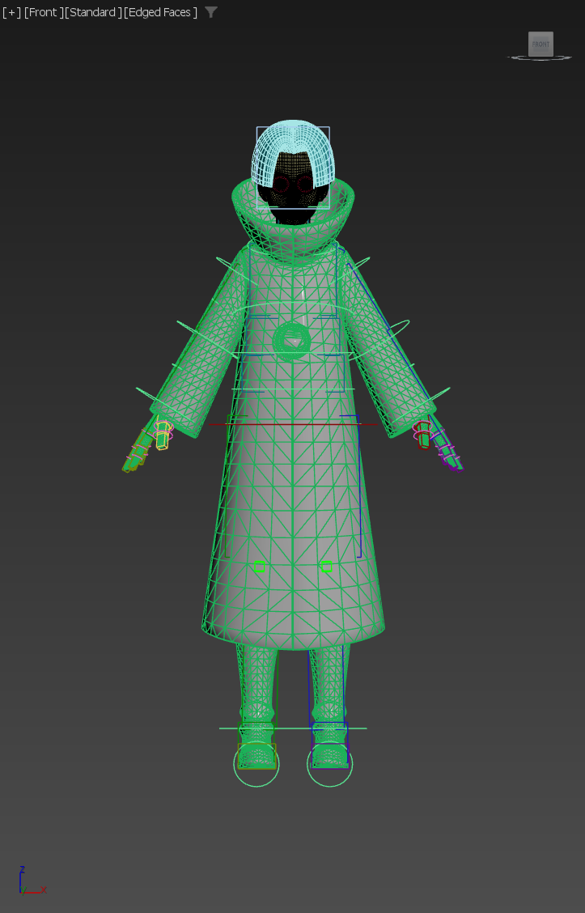
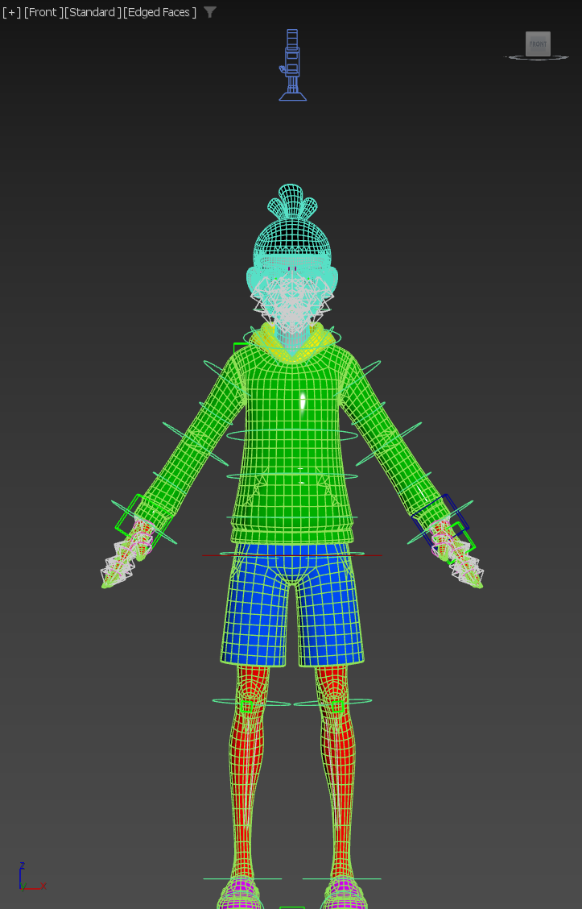

# Seven → Stan 流程验证报告（2026-10-19）

本轮从当前打开的原始 Seven 与 Stan 开始，完成 Biped 重建、测量驱动层、控制器迁移、静止对齐及行为测试。重建和迁移产物可供检查；严格流程验收未全部通过，下表明确列出三项失败。没有把既有完成副本作为输入、结构来源或数值参考。

## 输入与交付

| 项目 | 路径或状态 |
|---|---|
| 源窗口 | PID 25300，`E:/AI/3dMax/Save/Seven_Skin.max`，818 对象 |
| 初始目标窗口 | PID 30524，`E:/AI/3dMax/Save/Stan01.max`，59 对象 |
| 最终场景 | `E:/AI/3dMax/Save/Stan01_ProcessValidation_20261019_final.max`，1003 对象 |
| 源 figure | 本轮从 Seven 导出 `E:/AI/3dMax/Save/Seven_ProcessValidation_20261019.fig` |
| 静止真值 | [gRest_Stan.txt](gRest_Stan.txt)，本轮在目标无约束时取样，外部落盘 |
| 原始测试输出 | [test-results.json](test-results.json) |
| 部分执行片段 | [execution-fragments.json](execution-fragments.json)，包含排错片段，不能按文件顺序直接重放 |

原始 Seven、Stan 文件均未覆盖。最终目标窗口打开本轮 final 文件；源窗口重新载入原始 Seven，两个窗口均显示 Front / Standard / Edged Faces。源骨架、面部控制器和源网格在目标场景中保留但隐藏，没有执行源节点删除或 FBX 导出。

## 实测结果

| 检查 | 实测 | 结论 |
|---|---|---|
| 初始目标 | 55 Dummy；位置/旋转均为自由 Position_XYZ / Euler_XYZ；Skin 并集 54，Root 不蒙皮 | 通过 |
| Biped 结构 | 71 节点；spine 3 / neck 1 / leg 3 / fingers 5×3 / toes 1×1 / forearmTwist 2 | 通过 |
| 载入源 figure 的缩放抽查 | Pelvis [25.5303,31.977,16.4298]；L UpperArm [18.3378,37.7742,48.775]；Head [22.1781,22.152,30.1836] | 与源一致 |
| 三轮拟合 | 最大位置 0.0398436；最大朝向 0.0559529°；退出 Figure Mode、强制刷新后连续两读一致 | 通过 |
| 驱动层 | 55 个；建立时 UE 骨位移 0.0；驱动点与对应 Biped 最大位置差 8.54324e-06 | 通过 |
| 名字隔离 | bip001* 71 / SV_bip001* 71 / SV_* 126 / TGT_* 0 | 通过 |
| 骨控制器 | 验收的 52 骨全部 position_list + rotation_list；另两根 lowerarm twist 保留源位置与 LookAt 结构，Root 走独立驱动约束 | 通过 |
| 正向源引用 | 扫描 324 个保留节点，refs.dependsOn 未发现 SV_* 节点依赖 | 通过 |
| 控制环行为 | 双腕、双踝、双肩环 +5Z → 对应 UE 骨 [0,0,5]；Biped 位移 0；环与被测骨复位 0 | 通过 |
| Biped 根行为 | 根 +10Z → pelvis / head / 双手 / 双脚均移动约 [0,0,10]，复位 0 | 通过 |
| 最终重开静止 | 最大位置 0.00527058，最大朝向 0.104678°；52 骨均在 0.1 / 1° 内，连续两读一致 | 通过 |
| 显示 | boxMode 56/71；目标网格、控制器和 Biped 可见 | 通过 |
| 直接试动复位 | 最差位置残差 0.00474761（左前臂），超过 1e-4 | **未通过** |
| 保存→重开严格一致 | 相对保存前最大位置差 0.00511727（左前臂），四元数角差读数 0.0559529°；重开后仍在静止门槛内 | **未通过逐值一致要求** |
| 越界末端跟随 | 四链两段均各增长 10.000，但左臂链末端距手环 0.687708；源左臂同测约 0.001953 | **未完全复现源行为** |

四条链的上/下段长度分别为腿 35.3003 / 45.3889、臂 19.7845 / 20.6696。最终重开后链中关节位置误差最大 0.00178536，起点误差最大约 3.19e-05，均满足文档静止链几何门槛。

### 最终 Biped 姿势测试

每组从本轮 validated_base 载入；试动结束先直接复位并测世界位置残差，再重新载入里程碑以隔离下一组。表中位置/朝向是 52 根 UE 骨相对 BIPDRV 的最大值，直接复位误差覆盖 55 UE 骨、55 驱动点和本角色 71 个 Biped 节点。

| 姿势 | 最大位置差 | 最大朝向差 | 直接复位最大位置差 |
|---|---:|---:|---:|
| 右脚 +25Z | 0.000815554 | 0.104678° | 0.000115752 |
| 左脚 +25Z | 0.000672776 | 0.104678° | 0.000182750 |
| 右手 +25Z | 0.00185714 | 0.104678° | 0.000164427 |
| 左手 +25Z | 0.0229256 | 0.104678° | 0.00474761 |
| Biped 根 +10Z | 0.00192888 | 0.104678° | 0.0 |

姿势数值门槛均通过，但不能据此声称复位门槛通过。场景最终已从静止里程碑重开，没有保留越界拉伸或抬手抬脚姿势。

### 越界测试

将末端环沿起点到末端的方向拉到“当前两段总长 +20”。源与目标均依次测试右腿、左腿、右臂、左臂，测试后复位末端环；最后重新载入静止里程碑。

| 链 | 源上下段增量 | 目标上下段增量 | 源末端距离环 | 目标末端距离环 |
|---|---|---|---:|---:|
| 右腿 | 9.99987 / 9.99987 | 10.000 / 10.000 | 0.00903024 | 0.0000221 |
| 左腿 | 9.99987 / 9.99987 | 10.000 / 10.000 | 0.0149461 | 0.0000774 |
| 右臂 | 9.99901 / 9.99903 | 10.000 / 10.000 | 0.00195949 | 0.00323161 |
| 左臂 | 9.99903 / 9.99902 | 10.000 / 10.000 | 0.00195329 | 0.687708 |

增加 IK 迭代上限并收紧容差没有消除左臂越界差异；这项实验没有写入 final。这里仅记录可复现现象，尚未确认该差异的求解器原因。

## 本轮采用的顺序与调整

按验证时 quick-runbook 附录 C 的修正（现已合入[主流程](../../docs/quick-runbook.md)），先复制位置/旋转控制器并完成引用重指，再摆环、拟合链几何。所有目标坐标取本轮静止真值或 BIPDRV，没有从已受控制器影响的 UE 骨当前坐标取目标值。

Root 驱动点先摆静止再以 relative=true 跟随 Biped 根；两根 twist 测量点跟随普通前臂驱动点。复制 UE 骨控制器时保留 twist 的源控制结构。重指 61 个约束目标和 7 个本轮实际发现的 pickUpNode，12 个含 SV_ 目标的 Link Constraint 改为目标 Biped 的位置/方向约束。随后用正向依赖扫描覆盖保留骨架与控制辅助节点。

肩部起环的微小定位补偿移到父辅助点 Point040 / Point042，环本身的零位置归零；这样起点在抬手时仍跟随目标肩关节。脊柱 percent 在所有环对齐之后扫描，得到 Point001=49.991、Point002=100.0，没有直接写入文档案例的最优值。

伸缩原始表达式使用 Seven 半链长，且作用于局部 X。修改表达式文本、重接原 wire 的尝试出现了“文本已更新但实际驱动冻结”的现象；本轮没有把这种状态作为交付。final 的八个链段第二位置槽改用 Position_Script，显式绑定本角色起环和末端环，按“原始偏移 + 拟合后的局部段方向 × max(0, 起末距离/2 − Stan 半链长)”计算。此项是本轮对文档流程的实现调整，不是从完成副本提取的结构；它修复了两段伸长量，但左臂求解器末端误差仍未闭环。

文档把 Point001/002、Line001、Circle013 的 refs.dependents 中出现 SV_ 骨解释成了源引用残留。本轮检查显示，这些记录实际表示源骨依赖共享控制器节点。判断保留节点是否引用源骨，应同时核对正向 refs.dependsOn，不能仅凭反向依赖列表判定。本轮正向扫描结果为 0，源层仍保留为隐藏参考。

MAXScript 执行期间还遇到过原生访问异常，均未据此判定成功；恢复后使用本轮已保存里程碑继续。重新打开场景后，脚本应按名字重新解析节点，避免保留上次场景的控制器/节点包装器。

## 本轮里程碑

全部位于 `E:/AI/3dMax/Save/`，前缀为 `Stan01_ProcessValidation_20261019_`：preBiped → biped → fitted → driver → merged → ctrl_copied → chains → aligned → acceptance_base → validated_base → final。排错产生的 aligned_tightIK 文件不属于交付路径。

不能将本轮记为“一次跑通且全部门槛通过”。Biped 重建、常规姿势驱动和静止数值已通过；后续需要闭环的是直接复位、重开数值一致性和左臂越界末端误差。尚未进行 bake、FBX、UE 导入验证。

## 视口截图

