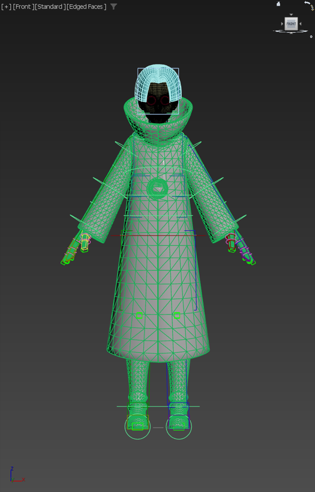

# Seven → Stan 独立流程验证（第二轮，2026-10-19）

本轮从两个已打开的原始场景施工：源 PID 25300 的 `E:/AI/3dMax/Save/Seven_Skin.max` 与目标 PID 30524 的 `E:/AI/3dMax/Save/Stan01.max`。执行依据为 quick-runbook、Biped 重建指南和控制器迁移指南。未打开、合并或读取历史完成的 .max 副本，也未读取历史验证目录中的脚本或数值作为施工输入。原始两个 .max 文件均未覆盖；源试动后重新打开原始 Seven 文件。

**结论：Biped 重建和控制器迁移已完成，严格整体验收未通过。** 最终施工场景为 `Stan_final.max`，施工结束时目标窗口已打开该文件。未通过项为直接复位、严格逐骨误差不增长，以及左腿越界末端与源的等价性。文件名中的 final/validated 不表示全部门槛通过。

本目录提交报告、测量记录、截图及复查脚本；`.max` 里程碑与源导出的 `.fig` 仅保存在本地。复查脚本保留本轮执行时的绝对路径，依赖本地场景；仅克隆仓库不能直接重跑，也不能把这些完成场景作为新一轮独立流程验证的输入。

## 输入与施工结果

| 项目 | 本轮结果 |
|---|---|
| 原始 Stan | 59 对象：55 Dummy、4 网格，无 Biped/IK |
| 自由骨架 | 55 骨 Position_XYZ / Euler_XYZ |
| Skin | Hair 1、Eye 1、Face 3、Body 54；并集 54，Root 不蒙皮 |
| 静止真值 | 本轮独立导出 [gRest_Stan.txt](gRest_Stan.txt)，55 个名字与高精度世界矩阵 |
| Figure | 本轮从原始 Seven 导出 `seven.fig`；装载后抽查 UpperArm、Head、Pelvis 的 scale 与源一致 |
| Biped | 71 节点；spine 3、neck 1、leg 3、fingers 5×3、toes 1×1、forearmTwist 2 |
| 拟合阶段 | 最大位置 0.0398436，普通骨朝向 0.0152045°；退出 Figure Mode 后连续读两次并跨调用复测 |
| 锁骨 | 几何求解使上臂起点误差左 0.00001641、右 0.00001471；随后重新对齐手指 |
| 驱动层 | 55 BIPDRV；建立时 UE 骨位移 0；普通驱动点随姿势位置误差约 0.0000086 内 |
| 名字隔离 | 总数 1003，唯一名 1003，目标 BIP 71、SV_BIP 71、SV 合计 126、TGT 0 |
| 重指 | 54 骨位置与旋转双树；61 个约束目标、7 个 LookAt 上方向、12 个 Link Constraint 替换 |
| Root / twist | Root 独立跟随 BIPDRV_Root；twist 保留位置→臂中点环、LookAt→腕环 |
| 保存重开静止 | 52 骨最大位置 0.0142241、朝向 0.0914145°，通过 0.1 / 1° 上限 |
| 引用复查 | 324 保留节点；305 约束、43 wire、0 script；正向源依赖与显式字段/绑定源引用均为空 |
| 显示 | boxMode 56/71；Stan 网格、目标 BIP、控制器可见，源骨架、网格和表情旁支隐藏 |

合并发现原始 Seven 内有两个 Bone054；仅在目标合并副本中将后一节点改为 Seven_Bone054_duplicate，未修改原始源文件。源遗留节点仍保留并隐藏，没有删除。

## 本轮实测的流程补充

1. 源右腿使用 IKHISolver，其余三肢使用 IKLimb。直接把任意方向的有效局部向量拟合到长度后，IKLimb 的末端曾偏离 0.13–0.31。将两段有效向量统一到局部 X 长度轴，第一槽写入 `[L,0,0] - p2` 后，静止末端降至 0.002 内。八条伸缩 wire 保留源结构，阈值改为本轮静止总长的一半；弯曲时第二槽为零，越界时沿同一长度轴伸长。未采用 Position_Script 替代。
2. 原始源六个 Expose 节点与其 Link 目标 Biped 骨的世界变换重合。转换为普通位置/方向约束时，relative=true 会保留错误的源角色世界偏移。本轮六个 Expose 改为 relative=false，极向点按本轮从源取得的父局部矩阵恢复，随后同时验证静止与弯姿势。
3. 肩环若在父辅助点之外保留补偿位移，该位移随上臂转动，会出现约 0.054 的位置增长。本轮把肩环移回父辅助点原点，并调整父辅助点位置；膝/肘环恢复与链中关节重合，起末端统一按 BIPDRV 落位，脚掌环通过普通父辅助点对齐。没有移动或旋转链关节来追逐末端。
4. 脊柱 percent 按本轮场景扫描得到 Point001=49.9913、Point002=99.9998；未硬填历史值。
5. 尝试把全部链改成 HI Solver 仍未达到所有直接复位门槛；该实验保存在独立文件中，未用于交付。最终保留源的四条求解器类型。目标链 posThresh=0.00001、iterations=1000；仅收紧这两个参数不能修正任意局部向量造成的末端误差。
6. 指南 figure 导出示例中的 `catch (...; throw exportError)` 在本机 Max 2026 编译失败；catch 内使用 `throw()` 才能重新抛出异常。本轮施工据此修正执行脚本，后续文档修订已同步改正指南。

## 最终静止链

比较对象为对应 BIPDRV 的世界位置，长度来自本轮落盘静止骨长。Biped 自身的拟合容差与辅助链求解容差分别报告，不混用。

| 链 | 起点误差 | 中点误差 | 末端误差 | 上段 / 下段 |
|---|---:|---:|---:|---|
| 右腿 | 0 | 0.000190895 | 0.000059915 | 35.3003 / 45.3889 |
| 左腿 | 0 | 0.00170763 | 0.00163508 | 35.3003 / 45.3889 |
| 右臂 | 0 | 0.000177476 | 0.000036677 | 19.7845 / 20.6696 |
| 左臂 | 0 | 0.0142246 | 0.00122267 | 19.7845 / 20.6696 |

四条链满足起末端 <0.002、中点 <0.02。详见 [最终复查](validated-metrics.txt)。

## 姿势与直接复位

每组先重载本轮 validated_base 隔离状态，按名字保存 324 个保留节点的矩阵；试动后直接恢复原末端位置，completeRedraw 后连续读值，比较全部被测节点。重载只用于组间隔离，不计为复位通过。

| Biped 试动 | 52 骨最大位置 / 朝向 | 全体直接复位最大位置残差 | 复位判断 |
|---|---|---:|---|
| 右脚 +25Z | 0.0142241 / 0.0914145° | 0.000144018，calf_r | 失败 |
| 左脚 +25Z | 0.0142241 / 0.0914145° | 0.00772576，calf_l | 失败 |
| 右手 +25Z | 0.0142241 / 0.0914149° | 0.000128722，lowerarm_r | 失败 |
| 左手 +25Z | 0.00170763 / 0.0914104° | 0.000927550，Point033 | 失败 |
| 根 +10Z | 0.0142940 / 0.0914177° | 0 | 通过 |

五组均通过 0.1 / 1° 的姿势上限。普通 BIPDRV 对对应 Biped 骨的最大位置误差 0.00000855、朝向 0.00001565°，没有出现缩放继承造成的漂移。根 +10Z 时 pelvis、head、双手、双脚均同向移动 10。

**逐骨误差不增长不能据全局最大值判定通过。** 本轮右脚姿势 calf_r 的位置误差较静止增长 0.000609457、thigh_r 朝向增长 0.000978192°；其余状态的增长量见 [完整姿势记录](validated-pose-tests.txt)。因此只确认数值上限通过，不宣称严格逐骨不增长通过。直接复位的唯一根因尚未确认；不能将重载恢复、替换求解器实验或单点 API 读数当成修复。

## 控制环与越界

双腕、双踝、双肩环分别 +5X，六个对应 UE 骨均移动 [5,0,0]，目标 Biped 位移均为 0。左肩环的全体复位残差 0.000734645，超过 1e-4；其余五组通过该复位门槛。

四肢分别把末端环沿起末端方向拉到静止两段总长 +20；原始源窗口采用相同测法，并在完成后重新打开原始 Seven 文件以清除试动残差。

| 链 | 目标两段增量 | 目标末端距环 | 原始源末端距环 |
|---|---|---:|---:|
| 右腿 | 10 / 10 | 0.000080048 | 0.00903024 |
| 左腿 | 10 / 10 | 0.0196540 | 0.0149461 |
| 右臂 | 10 / 10 | 0.000025033 | 0.00196579 |
| 左臂 | 10 / 10 | 0.00114014 | 0.00303117 |

目标四组越界直接复位均在 1e-4 内。等分伸长行为已验证；**左腿末端距环比源更大，不能宣称四肢与源完全等价**。源自身末端也存在非零求解误差，未经定义和验证的容差不能作为通过依据。完整结果：[目标行为](validated-behavior-tests.txt)、[原始源同测](stretch-source.txt)。

## 保存重开

保存前把同名 324 节点的矩阵保存到外部 [final-presave-transforms.ms](final-presave-transforms.ms)，另存 Stan_final.max 后重新打开，按名字重取全部节点和控制器，再比较同一批矩阵。

最大位置差为 0；以内存中的原始保存前矩阵逐分量比较，最大矩阵元素差也为 0。四元数误差计算返回的约 0.00000683° 与同一矩阵自比较的浮点残差相同，不代表实际变换变化。本轮保存重开一致性通过。重开后静止、节点计数、Root 例外及正向引用检查均重新完成。

当前视觉复核覆盖静止前视图；弯姿势下的大衣穿模、翻面以及 bake → FBX → UE 未验证。

## 复查入口与里程碑

- 重新打开 Stan_final.max 后，用 [bootstrap.ms](bootstrap.ms) 加载本轮名字映射和测量函数。
- [validated_pose_tests.ms](validated_pose_tests.ms) 重跑姿势与逐骨增长测试；[validated_behavior_tests.ms](validated_behavior_tests.ms) 重跑六个环和四肢越界。脚本会重载本轮基线，不能在含未保存用户修改的场景中运行。
- 主里程碑依次为 Stan_preBiped → Stan_biped → Stan_fitted → Stan_driver → Stan_merged → Stan_ctrl_copied → Stan_chains → Stan_aligned → Stan_expose_fixed → Stan_shoulders_fixed → Stan_driver_aligned → Stan_validated_base → Stan_final。
- acceptance_base、final_validation、HI_experiment 及其相关早期测量文件属于中间诊断，不能替代本报告中 validated-* 的最终结果。
