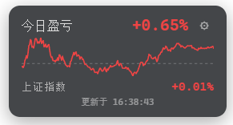

# dsh-ths-holdings

English | [中文](README.zh.md)

<p align="center">
  <a href="https://awesome-dsh-plugin.com"></a>
  <a href="https://www.npmjs.com/package/dsh-ths-holdings"></a>
  <a href="https://github.com/PM25000/dsh-ths-holdings"></a>
  
  <a href="https://www.npmjs.com/package/dsh-ths-holdings"></a>
</p>

A floating **position P&L card** for the [DeepSeek Harness](https://github.com/deepseek-ai/deepseek-harness) (DSH) web GUI. It automatically syncs your **real portfolio data** from the [Tonghuashun investment-ledger](https://tzzb.10jqka.com.cn) (同花顺投资账本) — no manual stock picking. Displays **今日盈亏** (today's P&L), **上证指数** (Shanghai Composite Index), and an intraday mini chart, all in the A-share red-up/green-down convention.

Unlike watchlist tools, this plugin reads your **actual positions** and shows your **real profit & loss** — both as a percentage and as a yuan amount — updating every 20 seconds.

## Screenshots



## Installation

```sh
dsh plugin --profile web add dsh-ths-holdings
```

Installation is `pnpm add` inside your web profile: the package's `dsh.bundle.patch` is applied to the profile layer automatically. Then **restart `dsh web`** — a floating card appears at the bottom-right corner.

Version `0.1.8` supports DSH `0.2.0-rc.1` and later `0.2.x` releases. Older plugin versions target DSH `0.1.x` and are rejected by the DSH compatibility check.

To install manually (without `dsh plugin`), edit `$DSH_HOME/profiles/web/package.json`:

```jsonc
{
  "dependencies": {
    "dsh-ths-holdings": "^0.1.8"
  },
  "dsh": {
    "profile": {
      "bundles": [
        // ...existing bundles,
        "dsh-ths-holdings"
      ]
    }
  }
}
```

then `cd $DSH_HOME/profiles/web && pnpm install` and restart `dsh web`. The plugin row itself comes from the package's `cordis.patch.yml` — you don't write it by hand.

## Usage

**Recommended — auto-acquire:**

1. Open the DSH web GUI — click **⚙** on the card.
2. Click **🖥 自动获取 Cookie（推荐）** — a system browser window opens (Edge / Chrome — the first installed one wins).
3. Sign in to the Tonghuashun investment ledger in that window (QR code / account).
4. When the sign-in succeeds the window closes itself, the Cookie is saved automatically, and the card refreshes with your portfolio.
5. The plugin auto-discovers your portfolio — if you have several, pick one from the dropdown. Done.

> The auto-acquired Edge window ships anti-automation camouflage (hides `navigator.webdriver`, disables the AutomationControlled Blink feature) to pass the Tonghuashun WAF. If a specific network/time still shows **Nginx forbidden**, press `F5` in the popped window or open [https://tzzb.10jqka.com.cn](https://tzzb.10jqka.com.cn) manually, then click **「我已登录，继续 →」** on the card; only `10jqka`-domain cookies are kept, never stored as raw plaintext.

**Manual (backup):**

1. Open [https://tzzb.10jqka.com.cn](https://tzzb.10jqka.com.cn) and log in.
2. Press **F12 → Console** and run:
   ```javascript
   copy(document.cookie)
   ```
3. The cookie is now in your clipboard.
4. Open the DSH web GUI — click **⚙** on the card, paste the cookie into **STOCK_PNL_COOKIE** → **save**.
5. The card validates the saved cookie immediately — it shows **✓ valid** or **✗ invalid** (with the reason/hint).

The session cookie expires eventually — when it does, the card shows a **Token 已过期** banner; re-open ⚙ and click **auto-acquire** (or repeat manual steps 1–4) with a fresh cookie (the `v` anti-bot token is handled automatically).

> 💡 After completing a new trade, re-upload your data from the investment-ledger **app** to the web version so your holdings stay consistent between the two.
>
> 

## Managing holdings (the plugin's own page)

This working copy ships the host half of `dsh-ths-holdings` only, so the day-to-day maintenance of the holdings sits on **the plugin's own page** — the same place the desktop pet's settings live: **Settings → Plugins → open the `dsh-ths-holdings` row**, where the page shows 持仓管理 (the `plugins.bundle.config` entry, keyed by this package, on this bundle's page).

- **See** — one row per holding with its code, name, quantity, and cost, plus the price, market value, cumulative P&L (against the position's own cost), and today's P&L (against the previous close) that the public quote feed gives; the account totals sit above the table, and unpriced rows are called out.
- **Edit** — change the code, name, quantity, or cost straight in the table and click save to write it back to the holdings file; discard-and-reload returns to the last loaded state.
- **Add and delete** — "添加一行" appends an empty row, and the row's "删除" control drops one.
- **Validate before writing** — the whole list is checked before anything is written (six-digit code, quantity > 0, cost ≥ 0, no repeated code); a rejected row is marked and explained, and one bad row means nothing is written at all.
- **Write-back** — saving replaces the holdings file atomically, keeps the `exported_at` / `export_date` / `source_file` the export flow wrote, and records an `updated_at`; the P&L card picks the new data up on its next poll (about 20 seconds), with no restart.
- **Choose the file** — the 持仓文件位置 row above the table shows the file in force and where that path came from. Type an absolute path or use 选择目录… (the shell's directory picker); **保存位置** remembers it for this machine only, in `$DSH_HOME/ths-holdings.location.json`, and **恢复默认** forgets it. The default is `$DSH_HOME/ths-holdings/positions.json`; the profile's `positionsFile` configuration applies when this machine has not chosen a path, and a chosen path overrides it.

> With a ledger Cookie configured, the card's figures come from the ledger API and the edits on this page only take effect on the "exported holdings + public quotes" local path — the page says so at the top.

The snapshot is personal data and never lives inside this package: point the setting at wherever you keep it, for example `D:\holdings\positions.json` inside a private checkout. That one file is shared with the `.xlsx` import: drop a fresh ledger export onto `ths-export-positions.bat` at any time to replace the whole list (it writes the same configured path), then keep fine-tuning it on the plugin's page.

## Features

- **📊 Real-time position P&L** — polls every 20 s (configurable) from your actual portfolio
- **¥ / % toggle** — show today's P&L as a yuan amount, a percentage, or both
- **📈 Intraday chart** — mini polyline with a zero axis, red-up/green-down
- **🇨🇳 Shanghai Composite Index** — displayed alongside your P&L
- **🔄 Auto-discovery** — `fund_key` is discovered from the portfolio list; multi-account selection via dropdown
- **🖥 Auto-acquire Cookie** — one click pops the Edge sign-in window; the cookie is saved automatically, no F12 needed
- **✓ Validate on save** — the stored cookie is checked against the ledger right after paste or auto-acquire
- **⚙ Holdings manager page** — Settings → Plugins → open `dsh-ths-holdings`: edit cost and quantity, add and delete holdings, with live market value and P&L
- **📁 File location setting** — choose where the holdings snapshot lives (default `$DSH_HOME/ths-holdings/positions.json`), so the real positions stay out of this public package and can sit in a private repository
- **↕ Draggable** — drag the title bar vertically along the right edge (position persists in localStorage)
- **⚙ In-place settings** — paste Cookie and select portfolio from the card itself
- **🔒 Credential-safe** — the Cookie never leaves the host process

## How it works

```text
┌─────────────── Web browser ───────────────┐
│  client.js (browser module)               │
│  · plugins.bundle.config → holdings page   │
│  · React (editable table over host routes) │
│          │ fetch (same-origin)             │
└──────────┼─────────────────────────────────┘
           ▼
┌─────────────── DSH Host (index.js) ───────┐
│  cordis plugin: webServer routes          │
│  · GET /api/stock-pnl          snapshot    │
│  · GET /api/stock-pnl/portfolios  accounts │
│  · GET /api/stock-pnl/verify     cookie ok?│
│  · POST /api/stock-pnl/acquire*   sign-in │
│  · GET|POST /api/stock-pnl/positions hold. │
│  resolves Cookie via ctx.credentials      │
│  auto-discovers user_id + fund_key        │
│  POSTs Tonghuashun ledger APIs            │
└───────────────────────────────────────────┘
```

The node half reads the login Cookie per request through the credential-reference seam (`ctx.credentials`) — it never reaches the browser. Credential-bearing requests never follow a redirect. The `v` anti-bot token is minted per request from the User-Agent; the stored Cookie only needs its session fields.

Auto-acquire runs an in-host state machine (`acquire.ts`): click the button → an anti-automation Edge window opens the ledger → once the sign-in is detected (`userid` cookie), the host collects that domain's cookies, commits them through the credential seam, and closes the window. Timeout, an early user window-close, or a WAF interception all surface as actionable notices on the card.

## Config

| Key | Default | Meaning |
|---|---|---|
| `cookieEnv` | `STOCK_PNL_COOKIE` | Credential reference holding the ledger Cookie. |
| `fundKeyEnv` | `STOCK_PNL_FUND_KEY` | Credential reference holding the ledger fund key (saved from the card's ⚙ form). |
| `user_id` | the Cookie's `userid` | The ledger user id, included in every form payload; an empty value falls back to the Cookie's own `userid`. |
| `fund_key` | auto-discovered | The ledger fund key selecting the managed portfolio; overridden by the `fundKeyEnv` credential when set, auto-discovered from the account list when empty. |
| `pnlUrl` | Tonghuashun `time_share` endpoint | P&L endpoint override (tests point at a scripted server). |
| `indexUrl` | Tonghuashun `getQuotes` endpoint | Index endpoint override (tests point at a scripted server). |
| `quoteUrl` | Tencent `qt.gtimg.cn/q=` | Batch quote endpoint override for the local source, shared by the P&L card and the holdings page (tests point at a scripted server). |
| `positionsFile` | `$DSH_HOME/ths-holdings/positions.json` | Path of the exported holdings snapshot the holdings page reads and writes. A path chosen on the plugin's page wins over this value (see Managing holdings). |
| `pollMs` | `20000` | Poll interval (ms) the card uses; reported to the browser in each response's `poll_ms`. |
| `minuteRefreshMs` | `120000` | How long one intraday series stays cached, in milliseconds. |

## Directory structure

This working copy follows the desktop pet's authoring style: the **hand-written ESM / lazy-CJS files are the artifacts**, so there is no `src/` → `lib/` step — and therefore **no `node_modules`, no build script, no lockfile**. At runtime it needs only the peer links `ensure-plugin-modules.bat` maintains under `_mytools\Plugins\node_modules` (junctions, 0 bytes).

```
dsh-ths-holdings/
├── index.js                # host half: webServer routes + credential resolution + config
├── fetch.js                # Tonghuashun ledger API calls + auto-discovery + cookie verify
├── acquire.js              # auto-acquire cookie (playwright-core drives Edge/Chrome)
├── local.js                # local quote source: exported holdings + Tencent quote feed
├── location.js             # where the holdings file lives: default, machine choice, validation
├── positions.js            # holdings page: validate and write
├── client.js               # browser half: the holdings manager on this plugin's own page
├── cordis.patch.yml        # dsh.bundle patch layer
├── package.json            # dsh.bundle + dsh.client manifests
├── vitest.config.ts        # the plugin's own test config (the repository's covers no path here)
├── tests/                  # ledger / verify / acquire / holdings-route specs + two keyless smokes
└── README.md
```

Tests (run them from the plugin directory; nothing needs building first):

```sh
..\..\..\node_modules\.bin\vitest.CMD run    # host half: 40 specs
node tests\positions-ui.smoke.mjs            # browser half: register, render, edit, save
node tests\host.smoke.mjs                    # boot the package by row name and drive the routes
```

## FAQ / Troubleshooting

| Symptom | Cause & fix |
|---|---|
| Card shows `请配置 Cookie` | `STOCK_PNL_COOKIE` is empty — click **auto-acquire** in the ⚙ panel, or paste manually. |
| Card shows `Token 已过期` | The session Cookie expired — click **auto-acquire** in the ⚙ panel to re-sign-in, or re-run `copy(document.cookie)` and paste. |
| Auto-acquire reports missing playwright-core | This working copy ships no build dependencies, so `playwright-core` is installed separately: `npm i -g playwright-core` (the plugin directory, the web profile, and the global npm root are all searched), then restart `dsh web`. |
| Auto-acquire window does not respond | Complete the sign-in in the popped window (QR code / account); the window closes and saves the Cookie after sign-in. |
| Popped window shows `Nginx forbidden` | The Tonghuashun WAF intermittently refuses automation — F5 in the window or open the ledger URL manually, then click **「我已登录，继续 →」**. |
| Saved Cookie shows `✗ invalid` | The Cookie expired or does not belong to an investment-ledger session — sign in again and retry; the panel displays the specific reason. |
| No portfolio in the dropdown | The account list needs a valid Cookie first; save the Cookie, then click ↻ to refresh. |
| Multiple portfolios | Select the one you want from the dropdown — the choice is saved as `STOCK_PNL_FUND_KEY`. |
| Cookie pasted with line breaks | The plugin strips whitespace on save, so wrapped lines are fine. |
| The plugin row has no holdings manager | The browser half follows the plugin roster the host computes at startup: **restart DSH** after changing the plugin (the desktop app, or `dsh web`); the page is **Settings → Plugins → `dsh-ths-holdings`** (the bundle group, the same route the desktop pet takes). |
| Saved, but the card's figures did not move | The card polls once per `pollMs` (20 seconds by default), so give it a round; with a ledger Cookie configured the card reads the ledger and this page only edits the local snapshot. |
| The save is refused and a row is marked | Fix the field it names: the code must be six digits, the quantity above 0, the cost 0 or more, and no code may repeat; nothing is written until the whole list passes. |
| The holdings page is empty | The file in force has no holdings yet — the 持仓文件位置 row shows which file that is; add a row and save to create it, or point the setting at the file that already has your positions. |
| The holdings file moved out of the plugin directory | That is the default now: the plugin no longer ships or reads a `positions.json` inside its own package. On a machine that still needs the old list, set 持仓文件位置 to where the list lives (for example a private repository clone), or re-run `ths-export-positions.bat`; the old committed copy remains in this repository's history. |

## Model Experience

None — the card is a browser-side overlay over a host data route and registers nothing model-facing.

#### KV Cache effect

None — the plugin contributes no prompt, schema, or result.

## Known Limitations

- **The ledger API is an undocumented, login-gated endpoint** — its response format can change and the Cookie expires; the plugin surfaces both as errors rather than retrying or caching.
- **The portfolio list endpoint (`account_list`) requires the Cookie to be saved first** — the portfolio selector appears after you paste a valid Cookie.
- **Auto-acquire reuses a system browser** — it needs `playwright-core` (no longer installed with this copy: run `npm i -g playwright-core` or put it in the plugin directory's own `node_modules`) and drives whichever of Edge / Chrome is installed (first found wins); with neither present auto-acquire is unavailable (manual paste still works) and the page says so explicitly.
- **No server-side polling** — the route fetches on each request and the card polls at the configured `pollMs` interval; there is no shared cache or push channel.
- **The holdings page only edits the local snapshot** — it reads and writes the configured holdings file and never writes back to the Tonghuashun ledger; the ledger side is still maintained in the ledger itself (re-export the `.xlsx` to replace the whole list).
- **It lives on the plugin's own page** — it uses the `plugins.bundle.config` seat the Plugins page gives a bundle (the desktop pet's settings use the same one), so it renders only while that bundle is open, and the browser has to reload the plugin roster: restart DSH after changing the plugin.

## License

[MIT](LICENSE)
