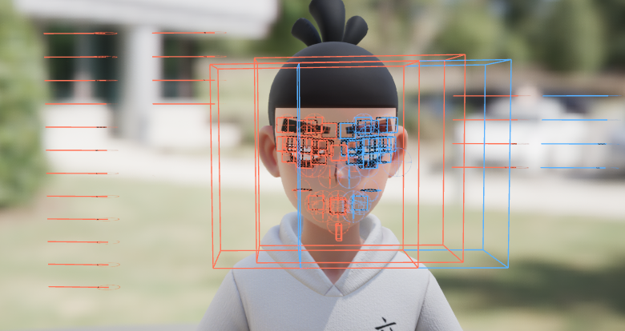
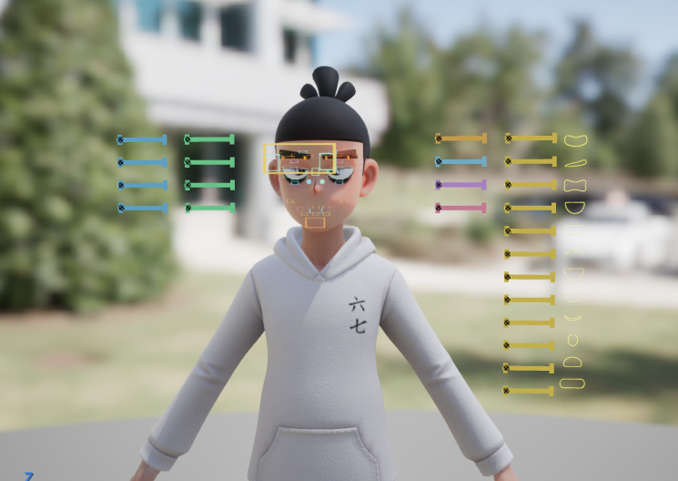

# 源驱动探测与 Control Rig 实现方法

执行顺序统一由 [Build.md](Build.md) 管理。本文只维护探测和实现方法；Seven 的精确名称见 [名称表](../Reference/ControllerNames.md)，数值映射见 [部位配方](../Recipes/SevenBrowsAndEyes.md)，当前资产见 [角色记录](../../Characters/Seven/README.md)。

默认先读用户指定的成熟 Rig，继承可用控制设计及求解结构，再用 Max 核查主动控制、完整驱动链、空间、范围和枢轴。允许复用已有实现，但仍须用源响应验证，不能只凭旧脚本或旧报告判为正确。没有差异的部分无需全部重新拟合。

以下 Seven 实测示例仅用于解释方法。它的坐标映射、149 骨及所有绝对坐标都不是新角色默认值。控制辅助体不是碰撞体；需要迁移的是它们的变换求值逻辑。涉及眼皮时先查 [上眼皮诊断](../Troubleshooting/UpperEyelid.md)和下眼皮配方。

## 1. 第一步：查清 Max 侧

### 1.1 先分清是骨骼、morph 还是两者都有

| 现象 | 判定 |
|---|---|
| 顶点动，骨骼不动 | 继续检查 Morpher、FFD、Skin Wrap 等修改器，不能仅凭顶点变化判定为 morph |
| 骨骼动，顶点跟随 | 至少有骨骼驱动，还需检查是否叠加 morph/修正变形 |
| 骨骼与 Morpher 通道值都变 | 两路驱动，需记录叠加顺序 |

面板、文字和样条形状可能只是显示。不能按 K_、Circle 或 Animcraft 前缀预判主动控制；沿绑定和响应确认真正入口。

### 1.2 运行 Max 探测脚本

3ds Max 装了 `3dsmax-mcp` 插件（`C:\ProgramData\Autodesk\ApplicationPlugins\3dsmax-mcp`），它在 `\\.\pipe\3dsmax-mcp-pid-<pid>` 上开命名管道，协议是「一行 JSON 进，一行 JSON 出」。

仓库里的 `Tools/FaceMigration/Scripts/max_run.ps1` 已经封装好：

```powershell
pwsh -NoProfile -File Tools/FaceMigration/Scripts\max_run.ps1 -ScriptFile Tools/FaceMigration/Scripts\probe_animcraft_world.ms
```

多开 Max 时用 `-MaxPid <pid>` 指定目标（默认取最近启动的 `3dsmax` 进程）；`Get-Process 3dsmax` 可看 PID 与当前场景窗口标题。

脚本里发的是：

```json
{"type":"maxscript","command":"( ...maxscript... )"}
```

命名管道历史封装返回 `{"success":true,"result":"...","meta":{...}}`，当前 MCP 工具外层可返回 `ok/result/error`，以实际协议为准。优先用专用检查工具，自定义采样再用 MaxScript。Safe Mode 会拦截部分功能，本次 Python 执行也被拒绝；它不保证脚本只读或自动恢复场景。

### 1.3 探测脚本要点

0. **先精确匹配用户名称表，不猜相似名**。调查未提供名称的源对象时才按前缀枚举：`for o in objects where (matchPattern o.name pattern:"zCircle*") collect o`，一次打印数量、类、父级、世界坐标。本次 49 个 `zCircle` 里只有 6 个是目标，目标靠「世界坐标 + 镜像成对」筛出来的。
1. 打印 `classOf`、`parent`、完整 transform、position/rotation list 以及 `transform.controller`。若为 Link_Constraint，读 `getNumTargets()` / `getNode(i)`，沿约束目标查虚拟体；普通父节点不是约束目标。
2. **用世界空间移动**再读结果，避免父级缩放干扰：
   ```maxscript
   in coordsys world move n [10,0,0]     -- 显式世界位移
   ```
   `.pos` 和移动都受坐标上下文影响，不应一律称为父空间。显式指定世界坐标，另记录父级缩放与控制限位。
   **例外：带 Position XYZ / 列表控制器的点控**（本次 `SYP_R001`、`XYP_R001`）移动节点本身不会驱动骨骼，被回弹或直接无效。必须写控制器值：
   ```maxscript
   local p2 = (getNodeByName "SYP_R001").position.controller[2]
   local orig = p2.value
   p2.value = [0, -0.875, 0]     -- 与 UI 行程对应的源轴值
   -- 采样后 p2.value = orig，并读回确认
   ```
   判断“控制无效”前先确认源值确实变了；先读 `position.controller[2].value` 原值，再设值、采样、恢复、读回。
3. 比较完整 transform：row4 查位置，rotation/矩阵查朝向；只查位置会漏掉原地旋转的枢轴。统一读 transform，避免依赖不同类型节点的 `.pos` 行为。
4. 保存完整 transform 和被修改的控制器各层原值，正常和异常路径都恢复并读回确认。复合控制器仅恢复 transform 不一定复原内部值；应恢复记录值，不能统一设为 0。
5. 单次测试的位移阈值用 `> 0.002`，只打印命中的对象名 + 位移，否则几百个对象刷屏。
6. 一次只测一个对象、一个轴；测完立刻复位再测下一个。

### 1.3.1 谁才是主动控制：三步判定

**不能按名字或父子关系猜。** 本次 `zCircle` 是 `KPoint` 的子对象，但主动的是 `zCircle`，父级 `KPoint` 反而被表达式锁死。

1. **看结构**：`position_list` 里有没有 `Position_Expression` / 约束 / wire。有表达式的点通常是从动。
2. **世界移动**：`in coordsys world move n [10,0,0]`，比较所有对象的位置与朝向；覆盖中性、有效行程和中间值。
3. **看是否复位**：移动后对象立刻回到原值 → 被表达式/约束锁死，是从动点。

| 移动后的现象 | 判定 | 本次例子 |
|---|---|---|
| 自身动 + 某根骨骼 **1:1** 动 | 主动控制，骨骼直接跟随 | `zCircle051` → `Bone010` |
| 自身动 + 多根骨/多个对象动 | 主控，继续拆每个对象的系数 | `Animcraft_*_Brow_Z_Ctrl` |
| 只有自身动 | 纯显示/形状（或只驱动顶点 morph） | 纯 UI 面板 |
| 自身不动（被弹回） | 从动点，被表达式锁定 | `KPoint051`（`MeiMao_SX` 表达式） |

> 旧脚本未成功读取表达式绑定（见 1.4），不代表所有 API 都不可读。能读取的约束目标与绑定先记录，再以响应采样确认。

### 1.4 表达式控制器

`position_list` 的第 2 项常是 `Position_Expression`。取公式：

```maxscript
local expr = (getNodeByName "meibu_R")[#Transform][#Position][2].controller
expr.getExpression()
```

旧脚本调用 `getNumVariables` / `getVariableName` / `getVariableTarget` 失败，只说明这些接口或调用不适用。不要因此跳过 Link_Constraint、参数连线等可检查的绑定；无法解析的表达式记为待查，用受控采样检查完整变换及必要的顶点响应。

### 1.5 记录表（填完再进 UE）

| 项 | 示例（Animcraft 右眉整体） | 示例（本次点控 `zCircle051`） |
|---|---|---|
| Max 对象名 / 类型 | `Animcraft_Right_Brow_Z_Ctrl`（NURBSCurveShape） | `zCircle051`（SplineShape） |
| 父级 | `Point471 → DAnimcraft_Master_GRP → … → BIPRoot` | `KPoint051`（被动，表达式锁定） |
| 坐标（Max 世界） | — | `(-1.178, -9.763, 161.442)` |
| 镜像对象 | `Animcraft_Left_Brow_Z_Ctrl` | `zCircle049` |
| 世界 X +10 | 整条右眉 +5 | `Bone010` +10 |
| 世界 Y +10 | 无效果 | `Bone010` +10 |
| 世界 Z +10 | 整条右眉 +5 | `Bone010` +10 |
| 驱动对象（精确名） | `meibu_R` + `Bone010/011/012` | `Bone010` 一根 |
| 系数 | `0.5` | `1.0` |
| 交叉影响 | 左眉完全不动 | 其余骨 = 0 |
| 是否带动 `meibu_*` | 是 | 否 |
| morph 参与 | 无 | 无 |
| 与其它控制的叠加 | 与点控同时驱动同一批骨 | 与整体眉控制同时驱动同一根骨 |

**系数 = 骨骼位移 ÷ Max 位移**，逐轴分别算；三轴不一致就说明有父级缩放或局部空间问题，先查再进 UE。

### 1.6 左右镜像配对

- 判据是**坐标**：X 取反、Y/Z 相同（本骨架 Y 是前后）。命名不一定对称——本次 `zCircle051` 的镜像是 `049`，不是 `052`。
- 配对后左、右各测一遍三轴。左右输出需按各自源数据和空间核对；镜像骨骼可能带不同局部轴和有符号缩放，不预设两侧数值或符号一致。
- 数量对不上时（比如 6 个点只找到 5 个镜像），先打印所有同前缀对象的世界坐标，按位置聚类，不要按名字猜。

---

## 2. 第二步：UE 侧结构

### 2.1 需要全量重建时再清空并重导骨骼

改资产前先备份：

```powershell
Copy-Item Content\_MyTest\Mouth\Rig\CR_Seven_MorphSliders.uasset Saved\Codex\Backup\..._<时间戳>.uasset
```

增量迁移不需要清空现有 Rig。`Tools/FaceMigration/Scripts/clear_rig.py` 会删除已有控制和图，只用于明确的全量重建并提前备份。它做的事：

1. 删掉除 `Begin` 外的所有 RigVM 节点（`ctrl.remove_node(n, False)`）
2. 删控制、null（控制先删，避免父级删除报错）
3. `import_bones_from_skeletal_mesh(mesh, 'None', True, True, False, False, False)`

   参数含义：`replace_existing_bones=True, remove_obsolete_bones=True`。Seven 骨架一次导入 **149 根**。

> 返回值只列「新加」的骨骼，已存在的不在列表里，别拿它当总数。用 `get_all_keys()` 统计。

### 2.2 控制类型

| Max 侧手感 | UE Control 类型 |
|---|---|
| 拖一个球/点，三轴自由移动 | `POSITION` |
| 只在一个平面里拖（滑条、2D 手柄） | `VECTOR2D` |
| 只是一个 0~1 的滑块 | `FLOAT` |

**已有动画接口需保持兼容**：修改控制类型会使 Sequencer 通道失配。需要变更时先保留旧轨迹，完成通道迁移或烘焙并对照动画，不能直接删除用户轨迹。当前空间滑块使用 POSITION 锁轴，也可实现单轴权重输入。

### 2.3 控制形状与摆放

默认读取示例各部位的形状库、形状名、shape transform、颜色、offset、轨道/端点、Visual Cue 和材质，再移植或按新角色尺度适配。下面的形状名和数值是历史方法示例，不是用统一 Box 或 Sphere 替换整个示例设计的配方。精确操作约定见 [主流程](Build.md)。

2026-11-10 用户提供的外观对照：



上图：上一轮采样重建版本，用户指出外观差异明显。可见密集框线、不同的面部手柄和线状面板。具体来源仍需读取设置并区分 shape、限位及选择状态，不能仅凭图片定因。



上图：用户提供的历史示例画面；当前参考资产为 `/Game/_MyTest/Mouth/SevenECR/CR_Seven_Expression`，目录与命名按[角色产出规范](Build.md#角色产出目录与命名2026-11-17-起)。需继承分组色、小型面部控制、清晰轨道/端点、口型图和整体比例；准确参数读取实际资产。两图视角和缩放不同，不能直接按屏幕像素反推厘米尺寸。

滑轨及口型图属于设计依赖，输入限位的可视化不是滑轨。先对齐无选择/单控选择/拖动时的显示状态，再处理多余框线。示例已有合理行程时保留行程和增益；不能为了拟合方便默认裁到 ±1 源单位，也不能对示例已缩短的下巴行程重复缩放。

| 目标 | 做法 |
|---|---|
| 手柄贴在目标部位 | `pos` 用**该部位骨骼的世界坐标**，不要凭感觉放 |
| 形状像一枚扁平条 | `Box_Thick`（粗线框盒），`shape_name='Box_Thick'` |
| 尺寸 | 见下方「手柄大小只能走 shape transform」 |
| 颜色 | `settings.shape_color = LinearColor(1.0, 0.42, 0.04, 1.0)`（橙） |

**5.8 的形状名有两套，别混：**

- 形状资产：`Engine\Plugins\Animation\ControlRig\Content\Controls\ControlRig_*.uasset`，例如 `Box_1mm` / `Box_3mm` / `Box_solid`。
- 默认形状库（实际生效的这套）：`/ControlRig/Controls/DefaultGizmoLibraryNormalized`，名字是 `Box_Thin` / `Box_Thick` / `Box_Solid`。
  `Box_Thick` 的 proxy 就是 `ControlRig_Box_3mm`（粗线框），`Box_Thin` 是 `ControlRig_Box_1mm`。
- 本项目所有眉毛控制统一用 **`Box_Thick`**。名字大小写必须与库里一致（写 `Box_thick` 不报错，但显示会回退）。

确认 shape_name 是否存在：

```python
lib = unreal.load_asset('/ControlRig/Controls/DefaultGizmoLibraryNormalized')
[s.get_editor_property('shape_name') for s in lib.get_editor_property('shapes')]
```

**手柄大小只能走 shape transform，绝不能改控制本身的缩放。**

控制是 `POSITION` 时，控制 transform 的 scale 会参与 gizmo 拖动换算。一旦设成非均匀缩放（比如用 `(0.42, 0.22, 0.05)` 把 `Box_1mm` 压成扁条），拖 1 cm 世界距离，控制值按 `1/0.05 = 20` 被放大，眉毛就飞出去 20 倍。而且三个轴比例不同，缩放方向的手感还会各不相同。

正确写法：

```python
# 控制 transform：只定位置，缩放必须是 1
off = h.get_global_control_offset_transform(k)
off.translation = unreal.Vector(*pos)
off.rotation = yaw
off.scale3d = unreal.Vector(1.0, 1.0, 1.0)
h.set_control_offset_transform(k, off, True, True)
h.set_control_offset_transform(k, off, False, True)

# 手柄外观：shape transform，只影响显示
shape_tf = unreal.Transform()
shape_tf.scale3d = unreal.Vector(0.42, 0.22, 0.05)
h.set_control_shape_transform(k, shape_tf, True)   # initial
h.set_control_shape_transform(k, shape_tf, False)  # current
```

两个坑：

- `RigControlSettings.shape_transform` 是**只读**属性，直接赋值会报 `read-only and cannot be set`，只能用 `set_control_shape_transform`。
- `initial` 和 `current` **都要设**。只设 current 时，编辑器里显示的仍是初始值（默认 1,1,1），看上去手柄依旧是巨大的一块。

**尺寸坑**：`Box`（无后缀）默认是 1 米级的盒子，`scale 1.9` 会直接糊满半个屏幕；`Box_Thin` / `Box_Thick` 才是 10 cm 级，且两者基准尺寸相同（Thick 只是线更粗，约 3 mm），所以从 `Box_1mm` 换 `Box_Thick` 时 **shape scale 不用改**。摆之前先想清楚基准尺寸。

**先量 Max 原手柄**：`numKnots` + `getKnotPoint` 算包围盒，本次六个 zCircle 直径约 0.8 cm；UE 里 `Box_Thick` 的 shape scale 按「目标直径 ÷ 10」估（0.12 ≈ 1.2 cm），再截图微调。点与点间距不足 3 cm 时，手柄别超过 1.5 cm，否则会互相压住。

**位置坑**：不要假设「Y 就是左右」。这具骨架 `meibu_L` 在 `(4.46, 7.49, 161.39)`、`meibu_R` 在 `(-4.46, 7.49, 161.39)` —— **X 才是左右，Y 是前后，Z 是上下**。按坐标轴直觉放会把两个手柄都甩到脑后。

### 2.4 控制挂哪儿

当前静止网格实验的控制挂 Root；以下坐标是 Rig/组件空间。角色移动或头部动画时，应把控制与枢轴放到适当的 head 空间，不能把固定静止坐标当作通用方案。offset 的 initial/current 都要设置：

```python
off = h.get_global_control_offset_transform(k)
off.translation = unreal.Vector(*pos)
off.rotation = yaw_quat
off.scale3d = unreal.Vector(1.0, 1.0, 1.0)   # 必须 1，原因见 2.3
h.set_control_offset_transform(k, off, True, True)   # initial
h.set_control_offset_transform(k, off, False, True)  # current
```

---

## 3. 第三步：驱动图与轴向

### 3.1 两个引擎的坐标系

本骨架（Seven）实测：

| | 3ds Max | UE（本骨架） |
|---|---|---|
| 上 | Z | Z |
| 前 | −Y | +Y |
| 左 | +X | +X |
| 手性 | 右手 | 左手 |

**换算：`UE = (Max.x, −Max.y, Max.z)`**，两边单位都是 cm。

验证方法：挑 2–3 根同名骨骼比世界坐标。本次实测：

- `Bone008`：Max `(1.178, −9.763, 161.442)` → UE `(1.178, 9.763, 161.442)`
- `meibu_L`：Max `(4.458, −7.490, 161.395)` → UE `(4.458, 7.490, 161.395)`

> 文档里常见的 FBX 公式是 `UE = (−Max.y, −Max.x, Max.z)`（对应 UE 前 +X、右 +Y 的朝向）。
> **本骨架不是那个朝向**（前 +Y），套错公式会让所有控制绕头转 90°。
> 永远先用骨骼坐标确认公式，再摆控制——这一步 30 秒，能省半小时。

### 3.2 GlobalSpace 还是 LocalSpace

**这批平移控制使用 `GlobalSpace` + `SetTransform`；其他控制仍需分析局部空间。** GlobalSpace 在 Control Rig 内指 Rig/组件空间，不是关卡绝对世界空间。

实测（`set_global_transform` 加 5 cm）：

| 空间 | `meibu_L` +X/+Y/+Z | `meibu_R` +X/+Y/+Z |
|---|---|---|
| Global | `(5,0,0)` / `(0,5,0)` / `(0,0,5)` | 同左，完全一致 |
| Local | `(-5,0,0)` / `(0,0,-5)` / `(0,5,0)` | `(5,0,0)` / `(0,0,-5)` / `(0,5,0)` |

`LocalSpace` 下左右两侧**符号相反**（`meibu_L` 带 `(-1,-1,-1)` 缩放），写「局部 Y = 世界 Z」只能对一侧成立，另一侧会反向。上一版就是这么写坏左眉的。

`GlobalSpace` 每根骨都直线位移、左右一致，所以图里读写都用 `GlobalSpace`，配合 `bInitial=True` 读初始值避免逐帧累积漂移。

### 3.3 节点与引脚

```
GetControlVector(CTRL, LocalSpace)          -- 控制通道值；全局映射取决于父级与 offset
   → VectorScale(Factor = 系数)
GetTransform(bone, GlobalSpace, bInitial=True)
   .Transform.Translation → VectorAdd(B = 偏移)
   .Transform.Rotation / .Transform.Scale3D
   → MathTransformMake(Translation, Rotation, Scale)
   → SetTransform(Item=bone, Space=GlobalSpace, bInitial=False, Value, Weight=1, bPropagateToChildren=False)
```

引脚坑：

| 坑 | 现象 | 正确写法 |
|---|---|---|
| `GetTransform.Transform` 的缩放子引脚 | `Cannot find pin '...Transform.Scale'` | 叫 **`Transform.Scale3D`** |
| `SetTransform` 的输入引脚 | 找 `Transform` 找不到 | 叫 **`Value`** |
| `SetTransform` 没有 AffectChildren | — | 用 `bPropagateToChildren` |
| `RigHierarchy` 没有 `set_translation` | `AttributeError` | 用 `set_global_transform` / `set_local_transform` |

### 3.4 系数

Max 里拖 10 cm → 骨骼 5 cm，UE 控制设 `±10`、系数 `0.5`。

**但系数不是固定的**：本次眉毛点控是 1:1（10 → 10），整体眉控制是 0.5。每个控制器单独测，别照抄上一个。
公式：`系数 = 骨骼世界位移 / Max 世界位移`；三轴分别核一遍。

### 3.5 与已有控制叠加（同一根骨有多个控制源）

本例两路都是纯平移，若两条 SetTransform 都从初始姿态构造目标，后者会覆盖前者。因此在 MAKE 前求偏移和，再设置一次。旋转、枢轴或明确有顺序的解算器需按各自空间合成；串行 SetTransform 本身并非一律错误：

```
GetTransform(bone, Global, bInitial=True).Translation
  → VADD1(A=初始, B=控制1偏移)      -- 已有
  → VADD2(A=VADD1, B=控制2偏移)     -- 新插
  → MAKE.Translation
  → SET
```

```python
# 先断开 MAKE 原来的 Translation 连接，再接回
ctrl.break_all_links('BROW_MAKE_%s.Translation' % bone, True, False, False)
ctrl.add_link(add2 + '.Result', 'BROW_MAKE_%s.Translation' % bone, False)
```

- UE 5.8.3 的 `break_link(output_pin_path, input_pin_path, ...)` 必须给出连接两端；要断开某个输入引脚的所有连接，用上面的 `break_all_links(pin_path, as_input=True, ...)`。重新接线前显式断开旧输入，并检查 `add_link` 返回值及最终连接。
- 当前 `build_brow_points.py`、左右眉弯曲脚本仍调用单参数 `break_link` 并吞掉异常；不能把它们当作已验证的通用接线模板。复用前适配正确 API 并验证最终连接；此问题保留为代码边界，证据见 [复核快照](../../Characters/Seven/Evidence/control_rig_recheck_2026-11-06.json)。
- 多条链共用 `bInitial=True` 的 GetTransform 是安全的，只要都读同一个初始值再相加。
- 幂等脚本要用**独立前缀**（本次用 `BPT_`），不要复用会被其它脚本整体清掉的 `BROW_`。

带旋转的叠加（新控制还影响骨骼朝向时）：

```
BT_Get(bone, Global, bInitial=True).Transform.Rotation
  → QuatMul(A=Delta_global, B=初始)   -- 增量已在 Rig 全局空间表达
  → MAKE.Rotation
Delta_global = QuatFromAxisAndAngle(Axis=已换算的全局轴, Angle=已验证的弧度角)
```

- 用 `break_all_links('BROW_MAKE_<骨>.Rotation', True, False, False)` 断开原输入连接；
- 局部增量右乘：`Initial * Delta_local`。顺序、轴的空间和符号须一起验证，不能一律取 `-dEuler`；眉毛参考实现见 [基础配方](../Recipes/SevenBrowsAndEyes.md)，完整要求见 [验证规范](Validation.md)。

---

## 4. 复杂控制的处理

| 源驱动 | 实现原则 |
|---|---|
| 纯线性平移 | 对每个目标、每轴独立测增益；多个贡献在最终写入前求和 |
| 正负不同响应 | 分别拟合正负分支，保留零点门控与冻结层偏置；脸颊和嘴角不能用同一条直线 |
| 虚拟枢轴 / Link Constraint | 读取约束目标和相对参考变换；先局部表达式，再枢轴运动，同时还原位置和朝向 |
| 眼球目标与眼皮联动 | 分别换算单眼和总控输入基；源表达式先求和还是先取分支必须保持 |
| Morph / 混合驱动 | 读取实际 Wire 和逐通道响应，确认所有目标都在 UE 网格中；不靠名称猜发音或左右 |
| 未导出的 FFD / Skin Wrap / 修正器 | 核查最终顶点贡献；无法用现有骨骼 / Morph 复现时补导目标或烘焙，记录资源缺失 |

## 5. 典型问题定位

| 现象 | 检查 |
|---|---|
| 手柄拖一点就飞很远 | 控制 / offset 的 scale 应为 1；显示尺寸用 shape transform，initial/current 都设 |
| 控制位置跑到脚底 | 检查改父级后的 Initial 通道及局部 offset；测试重置时不要先手工清零 |
| 旋转角大小正确却穿模 | 比较完整四元数，检查枢轴、旋转轴空间和乘法顺序；不能只修改限值掩盖有效范围内错误 |
| 眉眼一条链不动 | 遍历 Execute 全链、数据输入及最终写入；重建上游节点后恢复受影响下游连接 |
| 限位下多个输入结果相同 | 读取有效值和限位下面的原始值；按实际控制器设计采样，不把越界拖动量当有效行程 |
| 层级曲线有值、网格没变 | 查看正常动画帧的最终 Morph 曲线与绑定；必要时保留输入重开预览，参考表情配方 |
| 数值全为 0 却报告通过 | 检查测试实例层级非空、元素存在和控制确实产生有效响应 |
| 只旋转 / 移动头部后出现问题 | 核对 head / Rig / 组件空间；固定 Root 坐标的静止验证不证明动画适配 |

验证、持久化与输入恢复按 [Validation.md](Validation.md) 执行。工具、脚本目标和依赖见 [Tools.md](Tools.md)。用户自行确认画面；无需通过 computer-use 操作视口。
