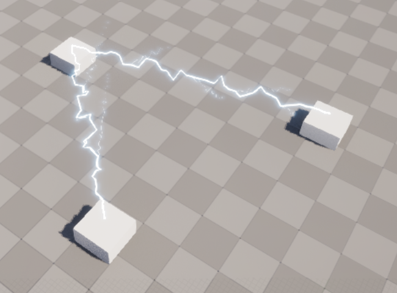

# Unreal Niagara 创建指南

这份教程说明如何通过 Unreal 编辑器与 MCP 创建可调、可跟随 Actor 的 Niagara 特效，并以三目标闪电链为实例。示例依据当前 UE 5.9 测试项目的实际资产和运行验证编写；工具名称与 Python API 需要在其他引擎版本中重新发现。

## 目录

- [准备环境](#准备环境)
- [先使用已有的闪电链](#先使用已有的闪电链)
- [创建 Niagara 特效的顺序](#创建-niagara-特效的顺序)
- [制作闪电的 Niagara 系统](#制作闪电的-niagara-系统)
- [制作 Actor 闪电链蓝图](#制作-actor-闪电链蓝图)
- [编译、保存与验收](#编译保存与验收)
- [继续查阅](#继续查阅)

## 准备环境

读者需要了解 Content Browser、Actor、Component，以及蓝图变量和函数的基本操作。Niagara System 管理完整特效，Emitter 负责一组粒子，Module 在不同阶段计算粒子的属性，Renderer 将粒子数据绘制出来。

本例环境：

| 项目 | 实测配置 |
|---|---|
| 引擎 | 当前机器安装的 UE 5.9 构建 |
| 项目目录 | `E:\Unreal\Projects\_TEST\MyProject5_9` |
| 示例关卡 | `/Game/_MyTest/M_Test` |
| MCP 地址 | `http://127.0.0.1:8001/mcp` |
| 项目启用的相关工具插件 | `EditorToolset`、`ConsoleToolset`、`SceneCaptureToolset`、`NiagaraToolsets` |

地址和插件属于本机环境配置。连接其他项目时，先读取编辑器启动日志中的 `Starting MCP server on port`，确认插件确实已加载，再调用工具。[MCP 工具发现与调用](mcp-reference.md)说明完整入口。

## 先使用已有的闪电链

1. 打开 `/Game/_MyTest/M_Test`，在场景中选中 `ChainLightning_MCP`。
2. 在 Details 的 `Chain Lightning` 分类下确认 `SourceActor = Cube`、`MiddleActor = Cube2`、`EndActor = Cube3`。
3. 点击播放或模拟，观察闪电依次从第一个目标推进到第二个、第三个目标，并周期性重复。
4. 需要更换目标时修改这三个 Actor 引用；需要复用时，将 `BP_ChainLightning` 拖入其他关卡，再指定该关卡的目标。

当前资产：

| 资产 | Content Browser 路径 |
|---|---|
| 闪电链控制蓝图 | `/Game/VFX/ChainLightning/BP_ChainLightning` |
| 单段闪电 Niagara System | `/Game/VFX/ChainLightning/NS_ChainLightning_MCP` |
| 复用的闪电材质 | `/Game/VFX/Lightning/M_Lightning_MCP` |

直接拖入 Niagara System 得到的是一段沿组件局部 X 轴延伸的闪电。目标引用、跳转时序和端点跟随由蓝图提供，因此需要使用控制蓝图来得到完整闪电链。



图片为完整连接的编辑器预览；逐段推进与延迟跳转需要在播放或模拟中观察。

## 创建 Niagara 特效的顺序

按“材质 → 单个 Emitter → 完整 System → 控制蓝图 → 关卡验收”的顺序搭建，可以逐层确认可见性、运动和交互。

| 层级 | 负责的内容 | 本例 |
|---|---|---|
| Material | 颜色、透明度、发光与横截面 | 闪电核心与光晕 |
| Emitter / System | 粒子生成、位置、寿命、宽度和分支 | 主干与四个细分支 |
| Blueprint | Actor 引用、实时端点、跳转和参数控制 | 两段闪电连接三个 Actor |
| Level | 实际目标、灯光、地面、相机与播放效果 | 当前三个 Cube |

先让单段闪电在 Niagara 预览窗口中稳定可见，再增加分支和目标控制。初次搭建时保留一个主干 Emitter，即可验证链路。

## 制作闪电的 Niagara 系统

### 1. 选择可验证的起点

在当前项目中，复制 `/Game/VFX/Lightning/NS_Lightning_MCP` 到自己的特效目录，可以得到已经配置好的 Ribbon 闪电。示例的 `NS_ChainLightning_MCP` 就使用这种方式创建。

从其他模板或空系统开始时，先在该编辑器中发现可用的 Beam / Ribbon 资产与模块，再配置下面的计算关系。模板名称和默认模块栈因引擎构建而异，不能把现有资产路径当作所有 UE 安装都具备的入口。

### 2. 确认材质能参与 Niagara 渲染

本例复用已有材质。自制材质时，需要将发光输出接到 `Emissive Color`，将粒子颜色和透明度接入实际输出，并确认材质支持 Niagara Ribbon。Unlit 与 Additive 可作为发光闪电的制作选择；材质更改后需要编译，确认 Renderer 使用的确实是这份材质。

先使用容易辨认的颜色和宽度检查形状，再调整发光和光晕。过高的亮度会掩盖闪电的弯折与分支。

### 3. 建立主干模块栈

下面是本例主干的配置关系。模块之间存在输入依赖，修改时应同时检查拓扑和输入值。

| 阶段 | 模块或属性 | 作用 |
|---|---|---|
| Emitter 属性 | `Local Space = true` | 闪电形状在组件局部坐标中计算 |
| Emitter Update | `EmitterState` | 循环与发射器生命周期 |
| Emitter Update | `BeamEmitterSetup` | 计算起点、终点 |
| Emitter Update | `SpawnBurst_Instantaneous` | 每轮生成主干粒子；本例主干为 49 个 |
| Particle Spawn | `InitializeParticle` | 粒子寿命和初始属性 |
| Particle Spawn | `SpawnBeam` | 建立沿束排列的 Ribbon 粒子顺序 |
| Particle Spawn | `BeamWidth` | 新粒子生成时读取宽度 |
| Particle Update | `ParticleState` | 更新粒子年龄并处理寿命结束 |
| Particle Update | `Color` | 亮度和透明度 |
| Particle Update | Set Parameters：`Particles.Position` | 每帧恢复到当前束上的基准位置 |
| Particle Update | `JitterPosition` | 在基准位置上增加闪电抖动 |
| Renderer | Ribbon Renderer | 使用闪电材质绘制主干 |

用于位置插值的 `t` 必须覆盖 0～1，并且与 Ribbon 的连接顺序一致。本例现有模板提供可用于该计算的 `Particles.RibbonLinkOrder`；另建模板时要确认这一点，必要时另外计算归一化进度。

### 4. 暴露参数并计算局部形状

Niagara User Parameters 中创建或确认这些 Float 参数：`User.Length`、`User.Width`、`User.Jitter`、`User.Intensity`。变量名必须与外部设置时的名字完全一致。

本例主干起点是局部原点，终点沿局部 X 轴：

```hlsl
// Beam End 的单一表达式
float3(User.Length, 0, 0)
```

在 Particle Update 中，先按起终点重新计算每个粒子的基准位置：

```hlsl
// Particles.Position 的单一表达式
Emitter.BeamStart + (Emitter.BeamEnd - Emitter.BeamStart) * Particles.RibbonLinkOrder
```

抖动只改变局部 Y/Z，并用 `sin(pi * t)` 在两端衰减。下面是本例的主干抖动表达式，可以填入 `Jitter Offset`：

```hlsl
sin(3.14159265 * Particles.RibbonLinkOrder) * User.Jitter * float3(0.0, 0.6 * sin(31.0 * Particles.RibbonLinkOrder + floor(System.Age * 14.0) * 1.7) + 0.4 * sin(91.0 * Particles.RibbonLinkOrder + floor(System.Age * 14.0) * 2.3), 0.65 * sin(43.0 * Particles.RibbonLinkOrder + floor(System.Age * 14.0) * 2.1) + 0.35 * sin(127.0 * Particles.RibbonLinkOrder - floor(System.Age * 14.0) * 1.3))
```

先重算基准位置，再叠加抖动，避免偏移逐帧累积。两端衰减保证主干端点仍落在目标连接点；宽度和颜色缩放分别读取 `User.Width` 与 `User.Intensity`。

### 5. 协调粒子循环与链路时序

Niagara 内部负责持续刷新可见的闪电形状，蓝图负责一次链式放电何时开始和结束。本例各 Emitter 的 Loop Duration 为 `0.12 s`，InitializeParticle Lifetime 为 `0.115 s`；它们与蓝图的放电周期是两组不同参数。

这一配置在本场景已通过视觉验证，但不表示任意帧率下都没有短暂空隙。调整寿命、循环或 Burst 后，需要检查间歇消失和多批粒子同时连接的问题；不要直接提高寿命而忽略 Ribbon 分组。

### 6. 增加细分支

主干验证后，再添加较细、较短的分支。分支起点取主干某个进度处的位置，并使用与主干相同的时间和偏移计算，保持连接；分支末端可使用独立方向和衰减宽度。

本例包含 `Beam`、`Branch_A`、`Branch_B`、`Branch_C`、`Branch_D` 五个 Emitter。分支仍属于同一段闪电，其长度和抖动会随组件参数更新。

## 制作 Actor 闪电链蓝图

### 1. 创建组件和目标引用

建立 Actor 蓝图 `BP_ChainLightning`，加入两个 Niagara Component：`Link_01`、`Link_02`，都使用单段闪电 System。组件设置为 Movable，并启用自动激活。

增加三个可在关卡实例编辑的 Actor 引用：`SourceActor`、`MiddleActor`、`EndActor`。第一段连接 Source → Middle，第二段连接 Middle → End。当前版本固定支持三个目标；任意长度的目标数组需要另外实现组件数量管理和遍历逻辑。

### 2. 添加可调变量

参数参考：以下是示例蓝图的默认值，而非 Niagara 或 UE 的全局默认值。

| 蓝图变量 | 类型 | 默认值 | 用途 |
|---|---|---|---|
| `HopDelay` | 浮点数 | `0.16 s` | 第二段相对第一段的启动延迟 |
| `TravelTime` | 浮点数 | `0.09 s` | 每段推进到下一个目标所需时间 |
| `FlashDuration` | 浮点数 | `0.42 s` | 每段允许显示的时间窗口 |
| `PulsePeriod` | 浮点数 | `1.1 s` | 整条闪电链的重复周期 |
| `Width` | 浮点数 | `5 cm` | 主干宽度 |
| `Jitter` | 浮点数 | `28 cm` | 形状抖动幅度 |
| `Intensity` | 浮点数 | `1` | 颜色亮度缩放 |
| `TargetOffset` | Vector | `(0, 0, 70) cm` | 各目标世界位置的统一偏移 |

本场景 Cube 的中心位于地面高度，因此默认将连接点抬高。使用其他模型时，根据模型原点和期望命中点调整 `TargetOffset`；要精确连接骨骼插槽，需要另外读取 Socket Transform。

推荐保持 `0 < TravelTime <= FlashDuration`，并使 `PulsePeriod > HopDelay + FlashDuration`，留出完整放电和间歇。本例只在计算中给部分除数设置下限，没有在 Details 中强制这些参数之间的关系。

### 3. 编写 UpdateChain 函数

创建 `UpdateChain(Animate: bool)`。函数针对两段闪电分别执行以下逻辑；本节是蓝图计算伪代码，不是可直接执行的 Python。

```text
Phase = GameTimeSeconds % max(PulsePeriod, 0.05)

对 Link_01 使用 SourceActor、MiddleActor、Delay = 0
对 Link_02 使用 MiddleActor、EndActor、Delay = max(HopDelay, 0)

如果起点或终点 Actor 无效：
    隐藏当前 Niagara Component
    跳过该段的位置读取
否则：
    显示当前 Niagara Component
    Start = StartActor.WorldLocation + TargetOffset
    End = EndActor.WorldLocation + TargetOffset
    Rotation = FindLookAtRotation(Start, End)
    Distance = VectorDistance(Start, End)
    设置组件世界位置 Start 和世界旋转 Rotation

    Progress = clamp((Phase - Delay) / max(TravelTime, 0.01), 0, 1)
    Active = Phase 位于 [Delay, Delay + max(FlashDuration, 0.02)]
    User.Length = Distance * (Animate ? Progress : 1)
    User.Intensity = Animate ? (Active ? Intensity : 0) : Intensity
    User.Width = Width
    User.Jitter = Jitter
```

这里旋转组件的局部 X 轴对准下一个目标，用 `User.Length` 控制局部长度。因此 Niagara 中保持局部坐标，蓝图中负责世界位置和朝向，两处计算才会对应。

### 4. 接入事件并设置预览

- Construction Script 调用 `UpdateChain(false)`，显示完整连接，方便检查目标和布局。
- Event Tick 调用 `UpdateChain(true)`，每帧更新端点、推进和导通窗口。
- 确认 Actor Tick 已启用；目标无效的分支也必须能继续处理下一段。

Construction Script 的执行不等同于编辑器持续 Tick。单独移动其他目标 Actor 后，当前蓝图不会保证立即重算；播放或模拟中的跟随已验证。需要刷新静态预览时，可重新触发控制蓝图的构造，或通过编辑器脚本调用 `UpdateChain(false)`。

### 5. 将蓝图放入关卡

把蓝图拖入关卡，指定三个目标，先检查完整连接的预览，再运行模拟。参数调整优先从 `Width`、`Jitter`、`HopDelay`、`TravelTime` 开始，每次只改变能明确观察的一项。

## 编译、保存与验收

1. 编译 Material、Niagara System 和 Blueprint，分别检查结果。MCP 请求成功仅代表调用得到响应，仍需读取资产编译状态。
2. 保存 Niagara、材质及蓝图资产，并单独保存关卡。关卡中保存的是目标引用和实例参数。
3. 运行播放或模拟，观察第一段先导通、第二段延迟导通、两段重叠和两段都关闭这四种状态。
4. 移动中间目标，检查第一段的终点及第二段的起点是否一起跟随。比较位置时使用 Actor 位置加上 `TargetOffset`。
5. 清空一个目标引用，检查对应闪电隐藏且没有无效对象访问错误。此项在模拟副本中测试，避免改变正式场景布局。
6. 停止模拟，确认场景回到编辑器状态，并复查保存的资产与关卡。

本例运行验证观察到四种导通组合、长度推进、中间目标移动后的连接起点误差 `0.0 cm`，以及中间引用为空时两段均隐藏。详细采样保存在 [验证数据](verification.json)。这些结果对应当前三目标场景，未覆盖打包、多玩家、任意目标数量和不同平台。

## 继续查阅

- [MCP 工具发现与调用](mcp-reference.md)：连接、Schema、Python 执行、Niagara 输入和截图。
- [常见问题与 API 注意事项](troubleshooting.md)：坐标、类型、蓝图生成、保存和运行环境。

维护说明：本目录是个人工具文档；引擎更新后，先重新发现 API，再更新操作示例和运行验证。项目内的阶段性生成脚本不构成一键安装器，本指南也不要求依次重放这些脚本。
