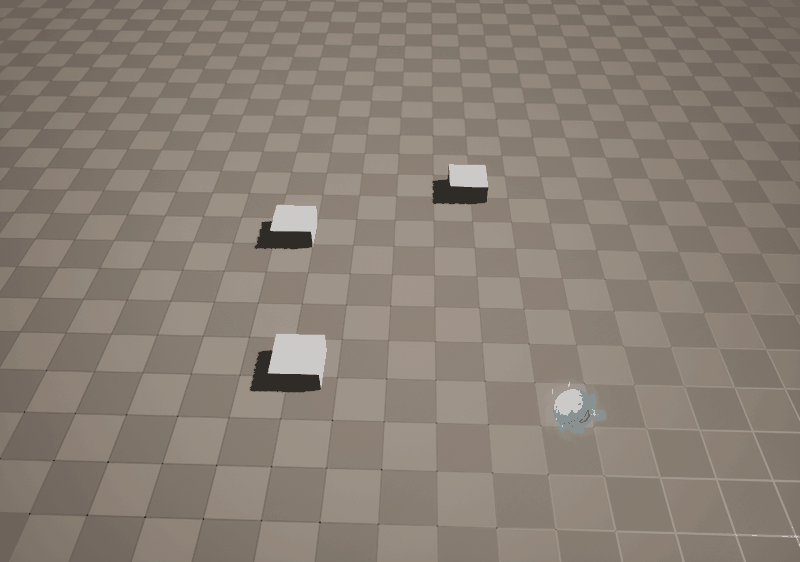
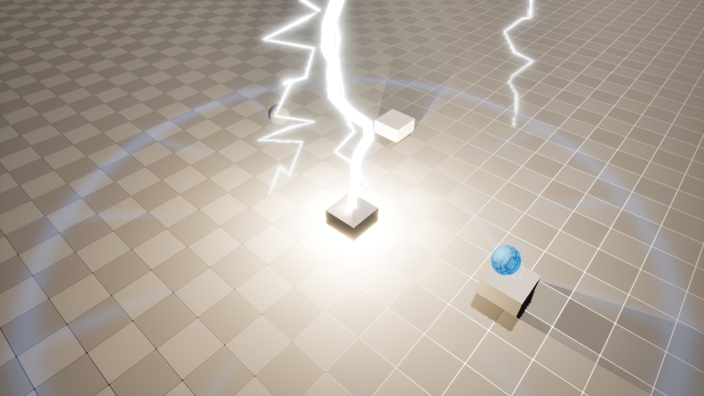

# Unreal Niagara 创建指南

## 概要

本指南以 UE 5.9 测试项目为例，通过 Unreal 编辑器和 MCP 创建两种 Actor 交互特效：一次触发、逐跳飞行的闪电链，以及参考巫妖“连环霜冻”表现的无限弹跳冰球。先在关卡中验证效果，再按对应教程创建 Niagara 和控制蓝图。

## 目录

- [准备环境](#准备环境)
- [在关卡中播放](#在关卡中播放)
- [创建新特效](#创建新特效)
- [验收结果](#验收结果)
- [继续查阅](#继续查阅)

## 准备环境

读者需要了解 Content Browser、Actor、Component 和蓝图函数。Niagara 的 System 管理完整特效，Emitter 管理一组粒子，Module 计算粒子属性，Renderer 绘制结果。

| 项目 | 本机示例 |
|---|---|
| 引擎 | 当前机器安装的 UE 5.9 构建 |
| 项目 | `E:\Unreal\Projects\_TEST\MyProject5_9` |
| 关卡 | `/Game/_MyTest/M_Test` |
| MCP | `http://127.0.0.1:8001/mcp` |
| 工具插件 | `EditorToolset`、`ConsoleToolset`、`SceneCaptureToolset`、`NiagaraToolsets` |

连接其他编辑器时，从运行日志确认 MCP 端口，并重新发现工具和 API。资产路径、模板内容和 Python 可用能力以对应构建为准，见 [MCP 参考](mcp-reference.md)。

## 在关卡中播放

当前场景用 Cube、Cube2、Cube3 作为三个不同目标。两个控制 Actor 的位置决定各自的发射位置；目标连接点由目标世界位置加 `TargetOffset` 得到。

### 冰球无限弹跳

1. 打开示例关卡，选中 `FrostChain_MCP`。
2. 确认 `Target1 / Target2 / Target3` 分别引用三个 Cube。
3. 点击 Play 或 Simulate。当前实例开启 `AutoTriggerOnBeginPlay`，会发射一颗冰球。
4. 观察冰球先飞到 Cube，然后从另外两个目标中随机选择下一个，持续弹跳。
5. 在运行世界中调用 `StopFrostChain` 停止，调用 `TriggerFrostChain` 从发射位置重新开始。

接到技能或交互事件时，关闭 `AutoTriggerOnBeginPlay`，持有控制 Actor 引用并调用触发函数。参数、材质和无限弹跳的创建步骤见 [冰球教程](frost-chain.md)。

此预览由运行世界的离屏渲染帧合成；GIF 本身会重复播放。

### 触发式闪电链

1. 选中 `ChainLightning_MCP`，确认 `SourceActor = Cube`、`MiddleActor = Cube2`、`EndActor = Cube3`。
2. 当前关卡实例关闭了闪电的 `AutoTriggerOnBeginPlay`，便于单独观察冰球。要独立演示闪电，开启它，并关闭冰球的自动触发。
3. 点击 Play 或 Simulate，观察“特效位置 → Cube → Cube2 → Cube3 → 结束”。
4. 运行中调用 `TriggerChain` 重播，调用 `StopChain` 立即停止。

闪电不会按固定周期自动重播。编辑器静止状态下，构造脚本将其隐藏；Call In Editor 按钮需要配合运行中的模拟实例观察动画。创建步骤和时间计算见 [闪电链教程](chain-lightning.md)。

### 天降闪电（宙斯大招）

1. 选中 `ZeusStrike_MCP`（位于 `(150, -460, 50)`，即 Cube2 顶面），确认两个 Niagara 组件指向 `NS_ZeusStrike_MCP` 与 `NS_ZeusImpact_MCP`。
2. 点击 Play 或 Simulate：主闪电从 3000 cm 高空竖直劈下直接命中 Cube2，同时 Cube 顶部炸开冲击环、火花与一次四段衰减的白光闪烁，约 1.2 秒后全部收尾。
3. 效果只在 `BeginPlay` 播一次；要看第二遍，重新进入 PIE 或再摆一个实例。

不用改蓝图就能调的参数在 Niagara 用户参数里：`User.Length`（3000，闪电长度）、`User.Width`（26）、`User.Jitter`（150，锯齿幅度）、`User.Intensity`（6，亮度）。分叉长度按 `User.Length` 的比例给出，改长度不需要逐条改分叉。资产、时间轴、复用方法和踩坑记录见 [天降闪电教程](zeus-strike.md)。

## 创建新特效

按下面的顺序搭建，每一步先确认可见结果，再进入下一步。

1. 创建材质，接好发光、透明度和粒子颜色，启用对应的 Niagara 渲染用途。
2. 创建单个 Emitter，确认生成方式、坐标空间、寿命和 Renderer。
3. 组合 System，检查各层的尺寸、数量、透明排序和生命周期。
4. 创建控制蓝图，管理目标、触发、运动、命中和停止。
5. 放入关卡，指定目标，检查编译、保存、运行表现和取消行为。

Niagara 负责外观，控制蓝图负责 Actor 目标与播放状态。直接拖入单个 System 不会得到完整的追踪与弹跳逻辑。

## 验收结果

记录日期为 2026-11-16。下列结果来自当前项目的模拟运行和编译检查，原始数据由 [验证索引](verification.json) 指向本目录的 `evidence/` 文件。

| 对象 | 实测结果 |
|---|---|
| 闪电链 | 初始隐藏、发射起点误差 0 cm、三跳依次出现、播放后不循环、再次触发重启、主动取消和无效目标取消 |
| 冰球 | 连续 14 次命中后继续弹跳，每次换一个目标，移动目标命中误差 0 cm，停止与重新触发生效 |
| 冰球粒子 | 第 14 次命中时：球核 1、光晕 1、旋转冰屑 34、拖尾 51；最老拖尾约 0.458 秒 |
| 冰球资产 | 两个 Niagara System 为 UpToDate，无编译错误或警告；Blueprint 无错误，资产与关卡已保存 |
| 天降闪电 | 3000 cm 竖直劈落劈中 Cube2，落点地面冲击环、56 颗火花与四段白光闪烁按 0.07 / 0.19 / 0.35 秒衰减，1.2 秒后两个组件归零；三个冲击发射器均为 `Once`，冲击环改 `CustomFacingVector` 后贴地（俯视可见完整圆环）；两个 System 编译 UpToDate 且无错误警告，蓝图与关卡已保存 |

这些记录不代表无限时长压力测试。当前示例固定三个目标，尚未覆盖打包、多玩家、伤害、敌我筛选、碰撞和不同平台；冰球也没有弹跳距离限制。

## 继续查阅

- [触发式闪电链](chain-lightning.md)：Ribbon 外观、短电弧飞行、三跳和参数。
- [天降闪电](zeus-strike.md)：Sky-strike 闪电、地面冲击环、点光闪烁时间轴与复用方法。
- [冰球无限弹跳](frost-chain.md)：球核、冰屑、拖尾、命中和目标选择。
- [MCP 参考](mcp-reference.md)：工具发现、参数编码、蓝图生成、强制编译、粒子采样和截图。
- [常见问题](troubleshooting.md)：坐标、触发状态、生命周期、编译与 Python API。

## 维护说明

本目录是个人工具文档。项目 `Saved/CodexLightning/` 中的脚本是创建和验证过程的辅助文件，部分脚本依赖已有资产或模拟状态，不构成可按文件名顺序执行的一键安装器。引擎或插件升级后，重新发现 API 并验证示例。
