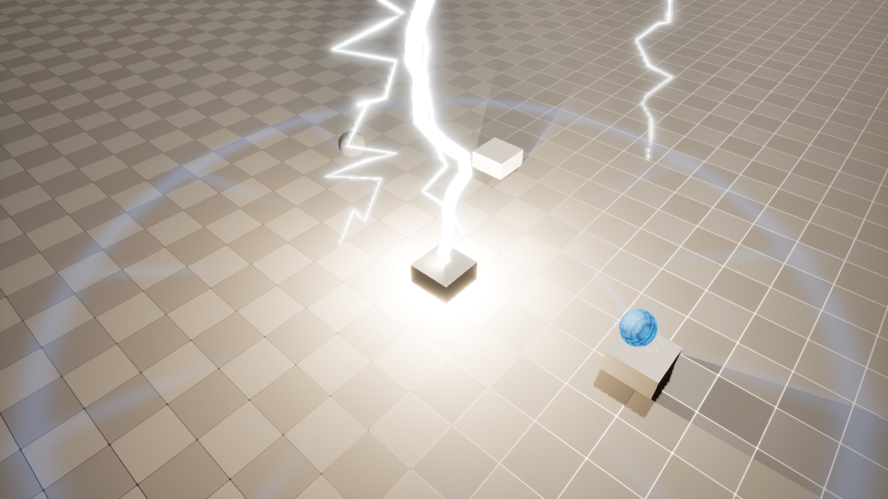
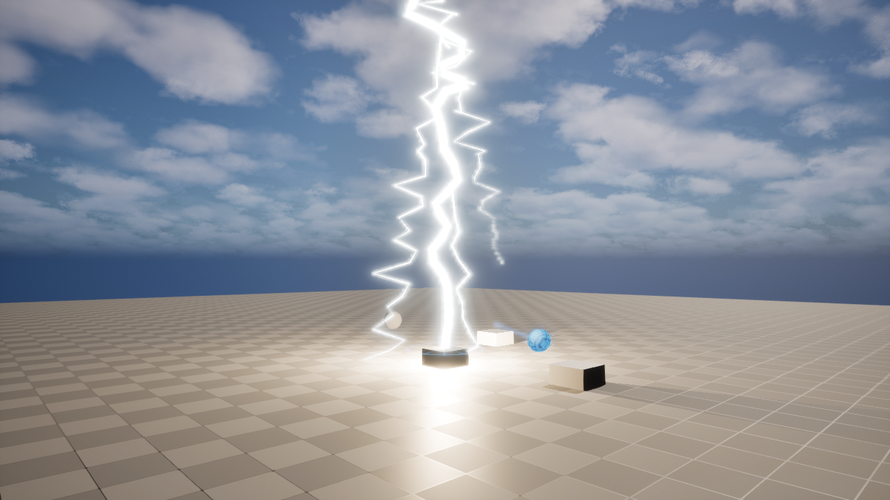
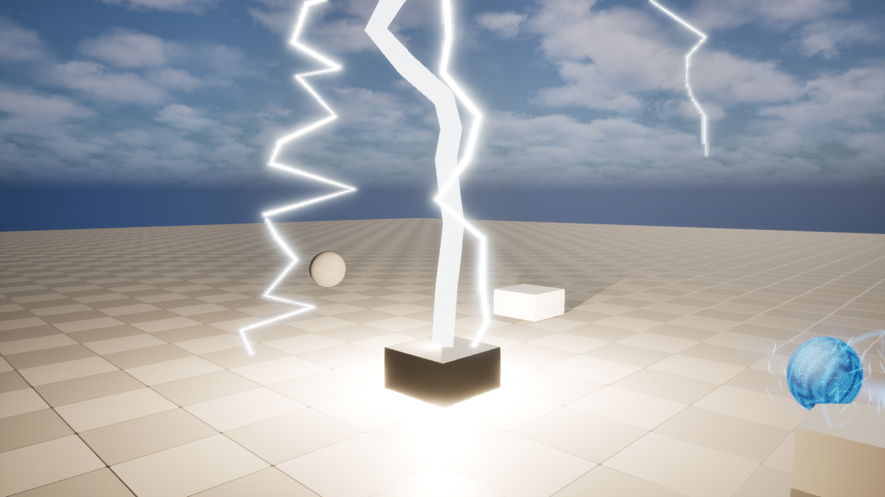

# 宙斯大招（天降闪电）特效 · Zeus Strike

参照 Dota 2 宙斯（Zeus）大招「Thundergod's Wrath」做的**从天而降劈向目标**的闪电特效。
在既有 `NS_Lightning_MCP`（闪电）与 `NS_FrostImpact`（冲击）基础上派生，全部为 Niagara + 蓝图，**无 C++、无新增贴图**。

## 资产

| 资产 | 说明 |
| --- | --- |
| `/Game/VFX/Zeus/NS_ZeusStrike_MCP` | 主闪电系统。`Beam` 主通道 + `Branch_A..D` 四条分叉，全部 Ribbon 渲染 |
| `/Game/VFX/Zeus/NS_ZeusImpact_MCP` | 落点冲击。`ImpactRing` 地面冲击环 + `IceBurst` 电火花 + `Flash` 接触闪白 |
| `/Game/VFX/Zeus/BP_ZeusStrike` | 控制器。闪电 + 冲击 + 点光源，`BeginPlay` 播放一次完整劈击 |
| `/Game/_MyTest/M_Test` 中的 `ZeusStrike_MCP` | 已摆放的实例，位于 `(150, -460, 50)`，正好在 `Cube2` 顶面上 —— 闪电就是劈这个 Cube |

## 蓝图结构

`BP_ZeusStrike`（父类 `Actor`）的组件：

- `DefaultSceneRoot`
- `Niagara` — `NS_ZeusStrike_MCP`，相对位置 `(0, 0, 3000)`，旋转 `Pitch = -90`（光束本地 +X 指向正下方）
- `Impact` — `NS_ZeusImpact_MCP`，位于原点（即 Actor 所在高度，劈 Cube 时就在 Cube 顶面）
- `FlashLight` — 点光源，Candela，颜色 `(184, 219, 255)`，`AttenuationRadius = 1800`，设计期强度为 **0**

`EventGraph` 时间轴（总长约 1.2 秒，一次性）：

| 时间 | 事件 |
| --- | --- |
| 0.00 | `Activate(Niagara)`、`Activate(Impact)`、`SetIntensity(1200)` |
| 0.07 | `SetIntensity(600)` |
| 0.19 | `SetIntensity(250)` |
| 0.35 | `SetIntensity(0)` |
| 1.20 | `Deactivate(Niagara)`、`Deactivate(Impact)` |

点光源强度的四段衰减模拟真实闪电的多次复闪，`Deactivate` 保证不留残影。
**只在 `BeginPlay` 触发一次**，因此重新进入 PIE 或重新摆放实例才会再播一次。

## 可调参数

闪电（Niagara 用户参数，可在 `NS_ZeusStrike_MCP` 或蓝图组件上改）：

| 参数 | 当前值 | 作用 |
| --- | --- | --- |
| `User.Length` | 3000 | 闪电长度（cm），与组件 Z 高度一致 |
| `User.Width` | 26 | 主干粗细 |
| `User.Jitter` | 150 | 折线抖动幅度，值越大越“锯齿” |
| `User.Intensity` | 6 | HDR 亮度倍率（配合加色材质） |

闪电形状要点：`EmitterState` 循环 0.08 秒（产生不断重抽的抖动）、`SpawnBurst` 81 颗粒子挤出 Ribbon、颜色 `(0.86, 0.94, 1.0)`、
透明度 `(0.35 + 0.65*|sin(Age*140 + RLO*37)|) * saturate(1.35 - 0.6*NormalizedAge)` 让主干高频闪烁；
分叉末端用 `User.Length * 系数` 表示，因此**改长度时分叉会按比例跟随**，不用逐个改。

冲击：

- `ImpactRing`：`Once`，寿命 1.0 秒，尺寸 `(220 + NormalizedAge*1900)`，颜色 `float4(0.72, 0.88, 1.0, pow(1-NormalizedAge, 0.75))`；
  渲染器 `FacingMode = CustomFacingVector` 且 `Particles.SpriteFacing = float3(0,0,1)`，所以**贴地**（默认 `Automatic` 会立成一个正对相机的圆环）。
- `IceBurst`：56 颗火花，速度 `1250` 径向迸射，材质 `M_FrostHalo`。
- `Flash`：1 颗，寿命 0.35 秒，尺寸 620，接触瞬间的白光。

点光源别开太大：贴着地面 1 米左右时，`Candela` 上万的强度会把整块地板打爆；当前 1200 → 600 → 250 已经够亮。

## 复用到别的目标

1. 把 `BP_ZeusStrike` 拖进关卡，放在目标脚下或目标顶面（`Impact` 与闪电都相对 Actor 原点）。
2. 目标越高/越矮时，调 `Niagara` 组件的 Z（= 闪电起点高度）并把 `User.Length` 改成同一个值。
3. 换颜色：改 `NS_ZeusStrike_MCP` 里每个发射器 `Color` 模块的 RGB，以及 `NS_ZeusImpact_MCP` 的对应模块。
4. 命中判定不在本特效内 —— 目前是纯视觉；要接伤害就在 `BeginPlay` 链首加自己的逻辑，或把整条链抽成函数由技能系统调用。

## 制作与验证方法（UE 5.9 + 本仓库 MCP）

- 资产全部通过 `NiagaraToolsets.NiagaraToolset_System` 的 `SetStackInputData` / `AddSetParametersModule` / `SetRendererData` 改出来，蓝图用 `unreal.BlueprintGraphEditor` 连线。
- **验证必须走 PIE**：编辑器世界的离屏 `SceneCaptureToolset.Capture` 不渲染 Niagara；但在 PIE 世界（`/Game/_MyTest/UEDPIE_0_M_Test.M_Test`）里对同一个 `Capture` 调用**可以**正常渲染 Niagara，且镜头可任意摆放 —— 这是拍最终展示图最省事的办法。
- 想抓住 1.2 秒内的每一帧：PIE 里先 `unreal.SystemLibrary.execute_console_command(world, "slomo 0.05")`，再把两个 Niagara 组件 `deactivate()` 后 `activate(True)` 重播，然后按真实时间 0.5~20 秒的节奏连续截图。
- 蓝图节点 API 的坑：`add_call_function_node` 只吃完整 `UFunction` 路径（`/Script/Engine.ActorComponent:Activate`），面板里的 `"Components|Activation|Activate"` 之类会静默返回 `None`；`set_pin_value` 传字符串；节点用 `get_node_title()` 判别（没有 `get_function_reference`）。
- 截图文件名按秒生成，同一秒连拍会互相覆盖 —— 连拍之间留 ≥1.1 秒。

## 展示图

| 广角（从天空落下劈中 Cube） | 俯视（地面冲击环） | 落点特写 |
| --- | --- | --- |
|  |  |  |
